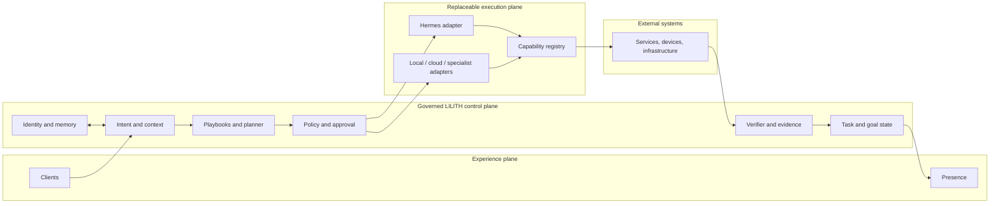

# Architecture Overview

LILITH is designed as a persistent governed system above replaceable execution substrates. The architecture separates identity and authority from model execution so
that changing Hermes, a model provider, a client, or a database does not silently create a different system or bypass policy.

## High-level architecture


## Architecture document hierarchy

| Document | Question answered |
| --- | --- |
| [Principles](principles.md) | What must remain true as the system evolves? |
| [System Context](system-context.md) | Who and what interacts with LILITH? |
| [AS-IS](as-is.md) | What is supported by current repository evidence? |
| [Target Architecture](target.md) | What architecture are we moving toward? |
| [Component Boundaries](component-boundaries.md) | What does each major part own and forbid? |
| [State and Data](state-and-data.md) | Where does durable truth live and how does it evolve? |
| [Runtime Boundary](runtime-boundary.md) | How do Hermes and future runtimes serve LILITH? |
| [Trust Boundaries](../security/trust-boundaries.md) | Where does data or authority cross into a less-trusted context? |
| [Slice 15B2b-A Canonical Runtime Foundation](slice-15b2b-a-canonical-runtime-foundation.md) | How are V2 proposals migrated, applied, packaged, and kept production-dark? |
| [Slice 15B2b-A Acceptance Record](slice-15b2b-a-acceptance-record.md) | What was accepted in source, proven in isolated DEV, and observed dark in PROD? |
| [Slice 15B2b-B1a Owner-Proof Contracts](slice-15b2b-b1a-owner-proof-contracts.md) | What synthetic WebAuthn proof is verified, and why is it not yet owner authority? |
| [Slice 15B2b-B1c Routine DEV Deployer Authority](slice15b2b-b1c-dev-deployer-authority.md) | How is routine DEV deployment cut off from root, broker, activation, Stage III and PROD authority? |
| [Slice 15B2b-B1c Acceptance Record](slice-15b2b-b1c-acceptance-record.md) | What did the real constrained DEV deployment prove, and what authority debt remains open? |
| [Slice 15B2b-B Owner Memory Control Design](slice-15b2b-b-owner-memory-control-design.md) | How can an owner-chosen memory eventually be accepted without the model, runtime, deployment, or a database write becoming authority? (design record) |
| [Slice 15B2b-B2a Accepted-Memory Contract and Verifier](slice-15b2b-b2a-accepted-memory-verifier.md) | What does the TEST-only verifier require before it returns ACCEPTED_MEMORY? (source implemented / test proven; live authority absent) |
| [Slice 15B2b-B1b-3 Authority and Key Custody Isolation Design](slice-15b2b-b1b3-custody-isolation-design.md) | How does authority-signing custody leave the application so that a compromised `lilith`, model, deployer, or DB writer cannot manufacture an accepted authority chain? (design record) |
| [Slice 15B2b-B1b-3a Authority Evidence and Key Registry Contracts](slice-15b2b-b1b3a-authority-registry-contracts.md) | What do the TEST-only registry, Owner/Actor evidence, and Privacy authorization contracts require, and how do retirement, compromise, environment, and epoch fail closed? (source implemented / test proven; live custody absent) |
| [Slice 15B2b-B1b-3b Broker-only Signing and L04 V2 Verification Adapter](slice-15b2b-b1b3b-broker-signing-l04-v2-adapter.md) | How does a TEST-only broker signer mint OwnerEvidenceV2 only after a consumed owner proof, and how does the L04 V2 adapter refuse rows, V1 HMAC evidence, and forged authority? (source implemented / test proven; live signing, live L04 V2 admission, and real custody absent) |
| [Slice 15B2b-B1b-3c Recovery Epoch and Registry Witness Semantics](slice-15b2b-b1b3c-recovery-epoch-witness.md) | How is `ledgerEpoch` bound to `RecoveryEpochV1`, and why can a restored, stale, or rolled-back ledger never revive authority, while historical evidence stays verifiable? (source implemented / test proven; live witness absent; whole-host rollback unresolved) |
| [Slice 15B2b-B1b-3d DEV_SYNTHETIC Authority Custody and OS Isolation Design](slice-15b2b-b1b3d-dev-synthetic-custody-design.md) | How would synthetic OWNER_ACTOR and recovery-witness keys be held on the real DEV host so that `lilith`, the routine deployer, and application deployment cannot read, replace, or mint authority, and a stale ledger is blocked by a surviving witness? (design record; not implemented; no key installed; no authority activated) |
| [Slice 15B2b-B1b-3d L1 DEV_SYNTHETIC Authority-Signer Source Foundation](slice-15b2b-b1b3d-l1-authority-signer-foundation.md) | Does the distinct `lilith-authority-dev` OWNER_ACTOR signer exist in source with an explicit OS boundary, reviewable install material, and fail-closed behaviour without custody material? (source foundation implemented; not installed; no credential; no authority) |
| [Slice 15B2b-B1b-3d L2 DEV_SYNTHETIC OWNER_ACTOR Custody Preparation](slice-15b2b-b1b3d-l2-custody-preparation.md) | What exact, owner-controlled ceremonies (L0, L1a–L1c, L2a, L2b) would install the signer and create the host-bound OWNER_ACTOR credential, with one mutation per step and no plaintext key on disk? (custody preparation source implemented; nothing executed; no key, blob, account, or unit created) |
| [Slice 15B2b-B1b-3d Routine DEV Deployer Authority-Boundary Hardening (DR-5)](slice-15b2b-b1b3d-deployer-authority-boundary.md) | Can a compromised routine DEV deployer prepare, modify, assume, or activate the future authority-custody domain, and how does each routine deployment prove it cannot, without counting absent paths as denials? (source control implemented; live denial not yet proven; DR-5 open) |
| [Slice 15B2b-B1b-3d DEV_SYNTHETIC Custody Preparation Live Closure](slice-15b2b-b1b3d-live-closure.md) | What did the completed live L0 through L2b.2 custody ceremony and post-K-ACT DR-5 routine deployment prove, what remained dark, and which residual risks remain open? (live closure; L2b.2 PASS; DR-5 closed; activation grant absent; DR-3 and whole-host rollback open) |
| [Slice 15B2b-B1b-3e Rotation, Revocation, Restore, and Recovery Semantics](slice-15b2b-b1b3e-rotation-revocation-recovery.md) | How does an authority key change, stop, or survive a restore without silent replacement, retroactive loss of valid history, or authority revived from restored bytes, and who requests, authorizes, executes, and verifies each transition? (design record; not implemented; no live mutation authorized; whole-host rollback unresolved) |
| [Slice 15B2b-B1b-3e Rotation, Revocation, Restore, and Recovery Source Contracts](slice-15b2b-b1b3e-source-contracts.md) | Which TEST-only contracts implement the accepted B1b-3e design: K-ROOT epoch and registry-head advance authorizations, RecoveryWitnessV2 head binding, additive registry succession, the single-current-key rule, the loaded-key binding, and the rotation state machine? (source implemented / test proven; live rehearsal not authorized; whole-host rollback unresolved) |
| [Slice 15B2b-B1b-3e Live-Rehearsal Entry Gate](slice-15b2b-b1b3e-live-rehearsal-gate.md) | Under what conditions may a DEV_SYNTHETIC B1b-3e live rehearsal even be designed: when compromise needs an epoch advance, how retained key material is classified, how the witness recovers from a torn publication, and how a successor credential is prepared side by side? (design / live gate only; RR-6, RR-7, RR-9, RR-11, RR-17–RR-21 owner-accepted; source work required before entry; no live rehearsal authorized; whole-host rollback unresolved) |
| [Slice 15B2b-B1b-3e Source Prep A: Witness Durability and Readiness](slice-15b2b-b1b3e-source-prep-a-witness-readiness.md) | How does the witness start at an owner-pinned V2 genesis, commit and recover durably without ever rolling back, re-verify the K-ROOT authorization behind every transition, and refuse readiness on an unexpected credential inventory or credential name (gate SW-3–SW-8)? (source implemented / test proven; live install absent; live rehearsal not authorized; whole-host rollback unresolved) |
| [Slice 15B2b-B1b-3e Source Prep B Design: Successor Custody and Compromise Recovery](slice-15b2b-b1b3e-source-prep-b-design.md) | How is a successor credential prepared, cut over, and the predecessor retired without dual-current or early destruction, which release and credential-name model serves rotations, and exactly how does current-key compromise recovery compose existing authority contracts (gate SW-1, SW-2, SW-9; RR-11-D1, RR-11-D2)? (design closure; RR-11-D1, RR-11-D2, RR-22–RR-30 and the compromise-epoch readiness rule owner-accepted; no owner decision pending; source not implemented; live rehearsal not authorized; whole-host rollback unresolved) |
| [Slice 15B2b-B1b-3e Source Prep B: Successor Custody and Compromise Recovery](slice-15b2b-b1b3e-source-prep-b-successor-custody.md) | How does a closed `successor <N>` keygen prepare a burned-ordinal successor beside an untouched CURRENT, how do bound HELD/RELEASED ceremony holds, the compromise-epoch rule, and the narrow C-4 gate keep every successor from readiness until an independently verified `S_CURRENT`, and how is the predecessor retired forward-only and logically destroyed (gate SW-1, SW-2, SW-9)? (source implemented / test proven; new authority-dev source release prepared, not installed; live install absent; live rehearsal not authorized; whole-host rollback unresolved) |
| [Slice 15B2b-B1b-3e PR-1 Live Install / Acceptance Preflight](slice-15b2b-b1b3e-pr1-live-install-preflight.md) | What exactly does the B1b-3d L3a–L4 prerequisite (gate PR-1) own, how is it split into source wiring, inert installation, and V2 bootstrap with owner acceptance, how is the installed `9ac7de2` release upgraded without looking like a fresh install, where do K-WIT, the authority ledger, the V2 genesis, the owner pin, and the hold store come from, and what evidence must the owner see before releasing INITIAL_CUSTODY? (live install design / preflight; no live mutation performed; RR-33–RR-40 owner-accepted, none pending; next slice PR-1S; PR-1 not authorized; B1b-3e live rehearsal not authorized) |
| [Slice 15B2b-B1b-3e PR-1S: Source / Runtime Wiring](slice-15b2b-b1b3e-pr1s-runtime-wiring.md) | Which single reviewed release can PR-1A later install: how the installed `9ac7de2` release is upgraded in place, how the live DEV_SYNTHETIC RecoveryWitnessV2, K-WIT custody, durable authority ledger, narrow C-4 wiring, RR-34 hold store, and independent root verifier with its RR-38 package digest are built, and how the deployer and custody denial proofs extend (preflight S-2 … S-15, S-20)? (SOURCE IMPLEMENTED / TEST PROVEN; LIVE INSTALL ABSENT; PR-1A NOT AUTHORIZED; B1b-3e LIVE REHEARSAL NOT AUTHORIZED; issuance unwired; whole-host rollback unresolved) |
| [Slice 15B2b-B1b-3e PR-1A Read-Only Live Preflight (Pass 1)](slice-15b2b-b1b3e-pr1a-readonly-preflight.md) | Does the live DEV_SYNTHETIC host still exactly match the accepted baseline required before the PR-1A inert upgrade of `9ac7de2`: host identity, installed release, unit state, signer account, CURRENT ciphertext identity, credstore inventory, host-key stat, PR-1 object absence, activation, DR-5, broker preservation, needrestart, and same-filesystem custody paths? (READ-ONLY LIVE PREFLIGHT; `PR1A_PREFLIGHT_PASS`; NO LIVE MUTATION; PR-1A INSTALL NOT YET AUTHORIZED; snapshot inventory NOT_COMPLETED_PR2; owner register NOT_COMPLETED_PR3) |
| [Slice 15B2b-B1b-3e PR-1A Reproducible Build / Attestation Gate](slice-15b2b-b1b3e-pr1a-build-attestation.md) | Does the exact reviewed source `aee323e` produce, in two independent clean builds, the byte-identical archive, manifest, units, fixed CLIs, and dependency inventory that PR-1A Pass 2 would install; what is the canonical non-authority build attestation; and do the installed-release verifier and the upgrade stages accept exactly that candidate? (REPRODUCIBLE BUILD / ATTESTATION; `PR1A_BUILD_ATTESTATION_PASS`; NO DEV MUTATION; PR-1A PASS 2 NOT AUTHORIZED) |
| [Slice 15B2b-B1b-3e PR-1A Final Read-Only Gate](slice-15b2b-b1b3e-pr1a-final-readonly-gate.md) | Immediately before M-A1, does the stored install candidate still match the accepted build attestation, and does the DEV host (identity, boot continuity, `9ac7de2` release, CURRENT, credstore, host key, inert units, PR1_ABSENT, activation, DR-5, broker, needrestart, filesystem) still exactly match the accepted pre-PR-1A baseline? (FINAL READ-ONLY GATE; `PR1A_FINAL_GATE_PASS`; NO LIVE MUTATION; M-A1 NOT AUTHORIZED) |
| [Slice 15B2b-B1b-3e PR-1A M-A1: Stage the Attested Release](slice-15b2b-b1b3e-pr1a-ma1-stage-release.md) | Was the exact attested candidate (`25f1ff03…`) staged beside the active `9ac7de2` release by the reviewed `upgrade-stage` only, with the selector, units, CLIs, CURRENT, services, activation, and broker unchanged? (M-A1 LIVE MUTATION; `M_A1_PASS`; STAGED RELEASE ONLY; ACTIVE RELEASE UNCHANGED; M-A2 NOT AUTHORIZED) |
| [Slice 15B2b-B1b-3e PR-1A M-A2: Select the Staged Release](slice-15b2b-b1b3e-pr1a-ma2-select-release.md) | Did the reviewed `upgrade-select` atomically move only the `current` selector from `9ac7de2` to the attested `aee323e` release, with both releases retained and units, CLIs, CURRENT, services, activation, and broker unchanged? (M-A2 LIVE MUTATION; `M_A2_PASS`; CANDIDATE SELECTED; UNITS/CLIS STILL OLD; M-A3 NOT AUTHORIZED) |
| [Slice 15B2b-B1b-3e PR-1A M-A3: Install the Reviewed Unit Bytes](slice-15b2b-b1b3e-pr1a-ma3-install-units.md) | Did the reviewed `upgrade-units` replace only the authority-dev service, socket, and tmpfiles files with the attested bytes, with no daemon-reload, no service action, CLIs still OLD, and CURRENT, custody, activation, and broker unchanged; and why does systemd already show the new definition? (M-A3 LIVE MUTATION; `M_A3_PASS`; UNIT ASSETS INSTALLED; SERVICES INERT; M-A4 NOT AUTHORIZED) |
| [Slice 15B2b-B1b-3e PR-1A M-A5: Install the Reviewed Fixed CLIs](slice-15b2b-b1b3e-pr1a-ma5-install-clis.md) | With M-A4 owner-skipped as not required (`UNITS_RELOADED`, `NeedDaemonReload=no`), did the reviewed `upgrade-cli` install exactly the six fixed CLIs with the attested bytes, with no daemon-reload, no service action, and CURRENT, custody, activation, and broker unchanged? (M-A5 LIVE MUTATION; `M_A5_PASS`; FIXED CLIS INSTALLED; SERVICES INERT; M-A6 NOT AUTHORIZED) |
| [Slice 15B2b-B1b-3e PR-1A M-A6: Retire the Predecessor Release](slice-15b2b-b1b3e-pr1a-ma6-retire-predecessor.md) | Did the reviewed `upgrade-retire-old` remove only `releases/9ac7de2…` after verifying NEW, leaving a single-release state that passes `status --expect L2b.2 aee323e…` with the selector, units, CLIs, CURRENT, services, activation, and broker unchanged, and may the merge freeze be lifted? (M-A6 LIVE MUTATION; `M_A6_PASS`; SINGLE-RELEASE STATE RESTORED; MERGE_FREEZE_ELIGIBLE_TO_LIFT, not lifted; M-A7 NOT AUTHORIZED) |
| [Slice 15B2b-B1b-3e PR-1A Transport Cleanup](slice-15b2b-b1b3e-pr1a-transport-cleanup.md) | Was only the verified M-A1 transfer directory (archive, stamp, baseline) removed from the operator home, with the host observation, release, units, CLIs, CURRENT, services, activation, and broker unchanged? (TRANSPORT CLEANUP ONLY; `PR1A_TRANSPORT_CLEANUP_PASS`; M-A7 NOT AUTHORIZED) |
| [Slice 15B2b-B1b-3e PR-1A M-A7: Inert Custody Root](slice-15b2b-b1b3e-pr1a-ma7-custody-root.md) | Did the reviewed installer `custody` stage create only the empty root-owned `0700` custody root, `prepared/`, and `retired/` on the credstore filesystem, passing `status --expect L2c`, with no credential, record, hold, witness, ledger, or service change? (M-A7 LIVE MUTATION; `M_A7_PASS`; INERT CUSTODY ROOT; post-M-A7 DR-5 pending the next routine run; M-A8 NOT AUTHORIZED) |
| [Slice 15B2b-B1b-3e PR-1A M-A8: Recovery-Witness System Account](slice-15b2b-b1b3e-pr1a-ma8-witness-account.md) | Did the reviewed `witness-account` stage create only the locked, nologin, home-less `lilith-recovery-witness` system user and group (994/984, no supplementary groups, no sudo), passing `status --expect P1A-8a`, with no units, K-WIT, witness state, or other change? (M-A8 LIVE MUTATION; `M_A8_PASS`; post-M-A7 DR-5 `P1A-7` recorded; post-M-A8 DR-5 pending; M-A9 NOT AUTHORIZED) |
| [Slice 15B2b-B1b-3e PR-1A M-A9: Recovery-Witness Unit Assets](slice-15b2b-b1b3e-pr1a-ma9-witness-units.md) | Did the reviewed `witness-units` stage create only the attested witness service, owner socket, signer socket, and tmpfiles file (root `0644`, O_EXCL), passing `status --expect P1A-8b`, with no daemon-reload, tmpfiles run, start, enablement, K-WIT, or witness state? (M-A9 LIVE MUTATION; `M_A9_PASS`; post-M-A8 DR-5 `P1A-8a` recorded; post-M-A9 DR-5 pending; M-A10 NOT AUTHORIZED) |
| [Slice 15B2b-B1b-3e PR-1A M-A10: Empty PR-1 Skeleton](slice-15b2b-b1b3e-pr1a-ma10-skeleton.md) | Did the reviewed `skeleton` stage create only the eight empty root-owned PR-1 skeleton directories, passing `status --expect P1A-9`, with no registry, register, K-WIT, witness state, ledger, hold, reload, tmpfiles run, or service change, completing the PR-1A mutation ladder? (M-A10 LIVE MUTATION; `M_A10_PASS`; P1A-8c satisfied without reload; post-M-A10 DR-5 pending; PR-1B NOT AUTHORIZED) |
| [Slice 15B2b-B1b-3e PR-1A Acceptance: DEV_SYNTHETIC Inert Installation](slice-15b2b-b1b3e-pr1a-acceptance.md) | On what evidence is the PR-1A inert installation of the attested `aee323e` release accepted, which live properties are accepted, and what does acceptance explicitly not establish? (ACCEPTED; DEV_SYNTHETIC INERT INSTALLATION ONLY; FINAL_MATURITY P1A-9; AUTHORITY_BOUNDARY PASS L1c.3; LIVE_MUTATION NONE; PR-1B, B1b-3e live rehearsal, and First Memory NOT AUTHORIZED) |
| [Slice 15B2b-B1b-3e PR-2: DEV Snapshot / Rollback Inventory](slice-15b2b-b1b3e-pr2-snapshot-inventory.md) | Which current and future authority and custody objects (K-ACT, host key, K-WIT, registry, head view, ledger, witness chain and pointer, holds, successor and retired slots, runtime credentials and sockets) would a disk snapshot, image, clone, provider backup, or host-local copy of the DEV host roll back together, and does any independently preserved freshness state exist? (READ-ONLY INVENTORY; `PR2_INVENTORY_COMPLETE`; no snapshot, image, or backup exists or ever existed; one disk, one filesystem; whole-disk rollback can present a self-consistent old authority world; whole-host rollback resistance NOT ESTABLISHED; NO MUTATION; PR-1B and First Memory NOT AUTHORIZED) |
| [Slice 15B2b-B1b-3e PR-2 Acceptance: DEV Snapshot / Rollback Inventory](slice-15b2b-b1b3e-pr2-acceptance.md) | On what evidence is the PR-2 snapshot / rollback inventory accepted, which findings and open risks are carried forward, and what does acceptance explicitly not establish? (ACCEPTED; `PR2_INVENTORY_COMPLETE`; WHOLE-HOST ROLLBACK RESISTANCE NOT ESTABLISHED; INDEPENDENTLY PERSISTED FRESHNESS STATE NONE; LIVE_MUTATION NONE; PR-1B, PR-3, and First Memory NOT AUTHORIZED) |
| [Slice 15B2b-B1b-3e PR-3: Owner / Off-Host Freshness Foundation](slice-15b2b-b1b3e-pr3-owner-offhost-foundation.md) | How can a DEV host restored to an old but cryptographically valid authority world be identified as stale: what owner-held, off-host, hash-chained `OwnerFreshnessRecordV1` register anchors "latest", what gives it authority (owner ceremony, not storage, Git, DEV, a model, or the witness), how authenticity and freshness (`CURRENT`, `STALE`, `AHEAD_UNACCEPTED`, `CONFLICTING`, `FRESHNESS_UNKNOWN`) are kept apart, and which owner-side operations stay blocked unless the presented world is exactly current? (DESIGN + PURE SOURCE FOUNDATION + P3-2 OFFLINE WORKSTATION TOOLING + P3-3 STORAGE GATE + P3-4 SYNTHETIC CEREMONY REHEARSAL (PASSED; does not close P3-3); `OFF_HOST_OWNER_FRESHNESS_ANCHOR`; PR3-D1..PR3-D12 OWNER-ACCEPTED; `P3_3_STORAGE_INCOMPLETE`: one real empty replica, second independent medium absent; no freshness record; no owner key; NO DEV/CLOUD CONTACT; whole-host rollback resistance NOT ESTABLISHED; PR-1B and First Memory NOT AUTHORIZED) |
| [Slice 15B2b-B1b-3e PR-3 Owner Freshness Ceremony Runbook (Template)](slice-15b2b-b1b3e-pr3-owner-ceremony-runbook.md) | What exact ten-step offline owner ceremony (inspect, classify, candidate, human review, digest confirmation, append A, intermediate state, append B, compare, classify CURRENT) must a future real owner freshness acceptance follow, and what must it never do? (PUBLIC-SAFE TEMPLATE; rehearsed synthetically in P3-4; NOT USABLE FOR REAL ACCEPTANCE while P3-3 is STORAGE_INCOMPLETE) |
| [Slice 15B2b-B1b-3e PR-3 P3-5: PR-1B Bootstrap Sequencing](slice-15b2b-b1b3e-pr3-pr1b-bootstrap-sequencing.md) | In exactly what order may PR-1B create K-ROOT, K-WIT, registry v1, the ledger genesis, the genesis pin, the witness genesis, owner freshness record 1 (two replicas), INITIAL_CUSTODY HELD and RELEASED, and FULL_READINESS without circular trust; which freshness gate applies to each step; and what are the points of no return and crash classes? (SEQUENCING DESIGN + PURE STATE MACHINE; three justified BOOTSTRAP_SPECIAL_CASE steps, no blanket bypass; PR1B_NOT_ELIGIBLE while P3-3 is STORAGE_INCOMPLETE; NO LIVE ACTIVITY; PR-1B, A1–A7 and First Memory NOT AUTHORIZED) |
| [Slice 15B2b-B1b-3e PR-3 P3-6: Owner Acceptance Envelope Foundation](slice-15b2b-b1b3e-pr3-owner-acceptance-envelope.md) | How is an explicit owner acceptance ceremony evidenced without changing the freshness record's identity? It uses an unsigned `OwnerFreshnessAcceptanceEnvelopeV1` binding the record digest, a reproducible review package, the genesis pin, and the custody set; it is chained one-to-one with records and stored in sibling acceptance stores, and its ACCEPTANCE_* states are kept apart from freshness. (FOUNDATION ONLY; REAL-PROFILE ACCEPTANCE HARD-BLOCKED WHILE P3-3 IS STORAGE_INCOMPLETE; no real envelope; authorizes nothing; PR-1B, A1–A7 and First Memory NOT AUTHORIZED) |
| [Slice 15B2b-B1b-3e PR-3 P3-3A: Android-Safe Create-Only Replica Publication](slice-15b2b-b1b3e-pr3-android-replica-publication.md) | Can Android/Termux app-private storage, where hard links are denied, publish owner freshness records create-only with the same security meaning, and with which primitive? (renameat2 RENAME_NOREPLACE backend preferred, hard link kept, direct O_EXCL evaluated but not admitted; per-backend probe; mixed backends allowed; standalone Termux probe; S25 NOT admitted; P3-3 remains STORAGE_INCOMPLETE; PR-1B and First Memory NOT AUTHORIZED) |
| [Slice 15B2b-B1b-3e PR-3 P3-3B: S25 Ultra Real Replica B Initialization Ceremony](slice-15b2b-b1b3e-pr3-p33b-replica-b-ceremony.md) | Exactly how is the empty real Replica B (`owner-offline-dev-synthetic-01`, DEV_SYNTHETIC) to be initialized in S25 Termux private storage? It covers a hash-pinned offline bundle from merged main `44a53f2`, USB/MTP transport through Download, gates G0–G2 (cryptography present, bundle verified, RENAME_NOREPLACE_V1 admitted), the single `init-real-replica` mutation, strict verification, and the public and private evidence templates. (PREPARED FOR OWNER EXECUTION; NOT EXECUTED; P3-3 remains STORAGE_INCOMPLETE; no record 1; PR-1B and First Memory NOT AUTHORIZED) ERRATUM (2026-09-29): the accepted Replica B is at `$HOME/lilith-owner-offline-dev-synthetic-01` (canonical), not the nested `$HOME/lilith-owner-freshness/…` path the design names; identity, manifest `c068e533…07c4`, and 0 records unchanged; not moved. |
| [Slice 15B2b-B1b-3e PR-3 P3-3: Real Owner Storage Acceptance](slice-15b2b-b1b3e-pr3-p33-storage-acceptance.md) | Do two real, empty, owner-controlled freshness replicas now exist in distinct rollback domains? Replica A is on laptop WSL ext4; Replica B is on S25 Termux private storage (RENAME_NOREPLACE_V1). The record covers the answer to whether one ordinary rollback can restore both (NO), the agent and backup posture, and the limitations. (`P3_3_COMPLETE`; TWO INDEPENDENT OWNER REPLICA STORAGE DOMAINS ESTABLISHED; 0 records; FRESHNESS_UNKNOWN; no record 1; real-acceptance block still in source; PR-1B NOT ELIGIBLE and NOT AUTHORIZED) |
| [Slice 15B2b-B1b-3e Pre-PR-1B Reboot and Rebaseline Ceremony](slice-15b2b-b1b3e-pre-pr1b-reboot-rebaseline.md) | Exactly how is the pending DEV kernel reboot performed before PR-1B, and how are the host, the broker baseline, P1A-9, OR-6 runtime directories, and the routine-deployer DR-5 boundary re-proven afterwards? One mutation (M-R1 reboot); the broker stays down after boot (RB-1), so the broker start is a separate M-R2; new read-only `rebaseline` verifier operation and offline PRE/POST observer comparator. (`PRE_PR1B_REBOOT_CEREMONY_READY`; NOT EXECUTED; REBOOT NOT AUTHORIZED; PR-1B NOT AUTHORIZED) |
| [Slice 15B2b-B1b-3e Pre-PR-1B Reboot: Evidence and Broker Rebaseline Acceptance](slice-15b2b-b1b3e-pre-pr1b-reboot-rebaseline-acceptance.md) | What did the executed reboot ceremony show (gate, M-R1, OR-6, M-R2, two stable rebaselines), and which new broker continuity baseline did the owner accept? (`POST_MR1_REBOOT_STATE_PASS`; `M_R2_BROKER_REBASELINE_PASS`; broker baseline `50003745…` on boot `eea461c3…` ACCEPTED, broker runtime scope only; OR-5 and OR-6 closed; §10 DR-5 pending on this merge; PR-1B NOT AUTHORIZED) |
| [Slice 15B2b-B1b-3e Broker Preservation Re-pin](slice-15b2b-b1b3e-broker-preservation-repin.md) | How does the broker verifier's `preservation` pin the owner-accepted post-reboot baseline (incarnation `84798e5b…`, candidate `50003745…`, boot `eea461c3…`) instead of the retired `42af2691…`? Includes the explicit process-identity pin and the accepted boot's Stage III controller contract. (`BROKER_PRESERVATION_REPIN_READY`; source/doc only; no authority, custody, or freshness transition; PR-1B NOT AUTHORIZED) |
| [Slice 15B2b-B1b-3e PR-2 Read-Only Revalidation (post-reboot)](slice-15b2b-b1b3e-pr2-revalidation.md) | Is the accepted PR-2 snapshot / rollback inventory still materially valid after the pre-PR-1B reboot, rebaseline, and preservation re-pin, and can whole-disk rollback still present a self-consistent old authority world? (`PR2_REVALIDATION_PASS`; no snapshots, images, or backups; single boot disk; OR-5 and OR-6 closed; OR-9 visibility-scope limitation only; rollback resistance NOT ESTABLISHED; PR-1B NOT AUTHORIZED) |
| [Slice 15B2b-B1b-3e PR-2 Read-Only Revalidation (pre-B-3/B-5 landing window)](slice-15b2b-b1b3e-pr2-pre-b5-revalidation.md) | Is the DEV persistence / rollback / freshness topology still the accepted PR-2 model just before the B-3 merge and the B-5 decision? Yes. The cloud inventory and IAM are byte-identical: one pd-balanced boot disk, no snapshots, images, schedules, backups, or buckets. The observer `stableSha256`, installer status, broker preservation, and units are identical. DR-5 results are identical; there is no package change and the same boot. The vTPM is unused, Replica A has 0 records, and there is no independent freshness. (`PR2_PRE_B5_REVALIDATION_PASS`; WHOLE-HOST ROLLBACK RESISTANCE NOT ESTABLISHED; B-3 HELD; PR-1B NOT AUTHORIZED) |
| [Slice 15B2b-B1b-3e PR-1B Eligibility Review](slice-15b2b-b1b3e-pr1b-eligibility-review.md) | Are all reviewed preconditions satisfied to authorize the real PR-1B authority bootstrap? Covers the live preconditions, the open-risk proposals, the hidden-assumption review, the Replica A/B policy, and the sequence check. (`PR1B_NOT_ELIGIBLE`: blockers are PR-3 tooling acceptance, open-risk acknowledgement, the source-level real-acceptance block, K-ROOT custody, and PR-1B authorization; no bootstrap activity) |
| [Slice 15B2b-B1b-3e PR-3 Owner-Freshness Tooling Acceptance](slice-15b2b-b1b3e-pr3-tooling-acceptance.md) | Which exact PR-3 owner-freshness source and tooling did the owner accept (main `7cef937`, tree `9292ec47…`, 13 files, scope digest `f7a76f37…`), and what does that acceptance not do? (ACCEPTED; closes PR-1B blocker B-1 only; REAL_ACCEPTANCE_ENABLED unchanged; no record 1; FRESHNESS_UNKNOWN; PR-1B NOT ELIGIBLE and NOT AUTHORIZED) |
| [Slice 15B2b-B1b-3e Owner Acknowledgement of Open DEV_SYNTHETIC Risks](slice-15b2b-b1b3e-open-risk-acknowledgement.md) | Which open risks did the owner acknowledge as DEV_SYNTHETIC precondition debt for entering PR-1B, with what guards and staleness conditions? Covers OR-1, OR-2/DR-3, cross-environment osAdminLogin, OR-3, OR-4, OR-7 and OR-8; OR-9 is a limitation only; OR-5 and OR-6 are closed. (ACKNOWLEDGED, DEV_SYNTHETIC only; closes PR-1B blocker B-2; not mitigation; not PROD; PR-1B NOT ELIGIBLE and NOT AUTHORIZED) |
| [Slice 15B2b-B1b-3e B-4 Decision: K-ROOT Custody and Genesis-Pin Topology](slice-15b2b-b1b3e-b4-kroot-custody-decision.md) | Where does K-ROOT live, where is its fingerprint authoritative, and where are the two M-B8 genesis-pin copies? Option A1: K-ROOT only in S25 Termux private storage, with the passphrase entered only on the phone; the fingerprint is authoritative on the phone; pin copies P-A (laptop) and P-B (phone), each outside the replicas; phone concentration accepted. (DECIDED, DEV_SYNTHETIC; real K-ROOT NOT authorized; PR-1B NOT ELIGIBLE) |
| [Slice 15B2b-B1b-3e B-4 Termux K-ROOT Capability Rehearsal](slice-15b2b-b1b3e-b4-termux-kroot-rehearsal.md) | How is it proven, before a real K-ROOT exists, that `root-keygen`, `registry-v1` and `reproduce` work on the S25 Termux with a throwaway TEST key and synthetic inputs? Covers the rehearsal script, the deterministic bundle builder, the phone commands, and the review gate. (PREPARED, NOT EXECUTED; TEST ONLY; real M-B1 NOT AUTHORIZED) |
| [Slice 15B2b-B1b-3e B-4 Termux K-ROOT Rehearsal: Final Bundle and Operator Package](slice-15b2b-b1b3e-b4-termux-kroot-rehearsal-staging.md) | Which exact bundle and Termux command block does the owner run on the S25 for the TEST-only K-ROOT capability rehearsal? Bundle `ff13bc6`, SHA-256 `659c50a4…`; covers STOP conditions, burned identities, and evidence. (`TERMUX_KROOT_REHEARSAL_READY_FOR_OWNER_EXECUTION`; NOT EXECUTED; real M-B1 NOT AUTHORIZED) |
| [Slice 15B2b-B1b-3e B-4 Termux K-ROOT Rehearsal: Evidence Received (Hold)](slice-15b2b-b1b3e-b4-termux-kroot-rehearsal-evidence-hold.md) | What did the owner's S25 rehearsal run show, and why is it not yet accepted? `B4_KROOT_REHEARSAL=PASS` and `REHEARSAL_GATE_PASS` are observed, the gate is reproduced on the laptop, six TEST identities are burned, and Replica B is byte-identical before and after. But the snapshots were not made by the reviewed `353c988f` `snap()`, and `verify.txt` / `g0.txt` / `evidence.sha256` are missing. Covers the read-only phone collection block and when a fresh TEST rehearsal would be needed. (`B4_REHEARSAL_EVIDENCE_HOLD`; NOT ACCEPTED; B-3, B-5 OPEN; PR-1B NOT AUTHORIZED) |
| [Slice 15B2b-B1b-3e B-4 Post-Hoc Evidence Acceptance and Fresh Rehearsal (Run 2)](slice-15b2b-b1b3e-b4-termux-kroot-rehearsal-run2.md) | What did the read-only post-hoc collection prove, and how is the one fresh TEST-only rehearsal run so that every reviewed run-time gate is captured? The collection is accepted: all hard gates passed, the seal verified, the phone and laptop tar hashes are equal (`4dbe4310…`), Replica B is continuous with run 1's baseline, and run 1's archive transport is now established. Run 2 uses `b4_phone_commands.run2.sh` (`f0768b6e…`), which is the reviewed `353c988f` block with a new staging directory and structural hard stops: `stop()`, top-level verify, checked rehearsal and gate exits, fail-closed evidence I/O, explicit cleanup. Every difference is a test-pinned diff. The earlier `aa0a33b0` (failed open) and `193da67a` (evidence I/O) are superseded. Covers the execution plan, transcript and export, the acceptance criteria, and offline checks. (`B4_POSTHOC_EVIDENCE_ACCEPTED_FRESH_REHEARSAL_REQUIRED`; run 1 NOT ACCEPTED; run 2 NOT STARTED at writing, since EXECUTED and ACCEPTED; B-3, B-5 OPEN; PR-1B NOT AUTHORIZED) |
| [Slice 15B2b-B1b-3e B-4 Termux K-ROOT Rehearsal: Acceptance (Run 2)](slice-15b2b-b1b3e-b4-termux-kroot-rehearsal-acceptance.md) | Is the B-4 S25/Termux K-ROOT capability rehearsal accepted, and what closes? Run 2 (script `f0768b6e…`, bundle `ff13bc6`) ended `RUN_EXIT=0` with no STOP and every reviewed gate token in order. The gate was reproduced on the laptop, the 8 evidence hashes verify after prefix rebasing, and Replica B is byte-identical before and after (`c068e533…`, 0 records). Six new TEST identities are burned. Run 1 stays `PASS_OBSERVED` / `INCOMPLETE`; run-2 tar transport is not claimed without the phone-side hash. B-4 CLOSED. (`B4_TERMUX_KROOT_REHEARSAL=ACCEPTED`; B-3, B-5 OPEN; no real K-ROOT; `REAL_ACCEPTANCE_ENABLED` unchanged; PR-1B NOT AUTHORIZED) |
| [Slice 15B2b-B1b-3e B-3: Real-Acceptance Switch and Burned-Identity Enforcement](slice-15b2b-b1b3e-b3-real-acceptance.md) | What exactly closes B-3, and why is it not PR-1B authorization? `REAL_ACCEPTANCE_ENABLED = True` enables only the real freshness `append` and `append-envelope`; the disable reason becomes `REAL_ACCEPTANCE_DISABLED_IN_SOURCE`. The 12 burned B-4 rehearsal identities (root, witness, and registry keys; registry digests; genesis digest, each mapping verified) are refused at propose, package, append, and append-envelope. Tests prove that B-3 != B-5, that M-B1 is not authorized, that freshness is UNKNOWN with 0 records, and that one replica is never CURRENT. (`B3_PATCH_PREPARED_NOT_LANDED`; held until immediately before B-5; B-3 OPEN on main; PR-1B NOT AUTHORIZED) |
| [Slice 15B2b-B1b-3e Burned Identity Set Expansion (12 → 20)](slice-15b2b-b1b3e-burned-identities-expansion.md) | Which identities are permanently burned and mechanically refused? 20: the 12 phone-rehearsal identities plus 8 real-format TEST identities that were printed (B-4 path-correction simulation: 6; first M-B1 simulation: 1; a failing M-B1 pty test: 1). Also covers the rule that simulations and tests must redact generated identities, and the unrecorded ephemeral-key class. (`burned_identities.py` CANONICAL_COUNT = 20) |
| [Slice 15B2b-B1b-3e B-5: PR-1B Owner Authorization Decision Packet](slice-15b2b-b1b3e-b5-pr1b-authorization-decision.md) | What would authorizing PR-1B mean, and what must the owner decide? Every eligibility input is checked against its record, and an in-memory `evaluate_eligibility` gives `PR1B_NOT_ELIGIBLE` with only `PR1B_NOT_AUTHORIZED` (`PR1B_ELIGIBLE` if set). Covers the exact effect of `pr1bAuthorized`, what is and is not permitted, the M-B1-first sequence and its points of no return, custody obligations, accepted debt, stop conditions, and GRANTED / WITHHELD templates that require a separate M-B1 go statement. (`B5_OWNER_AUTHORIZATION_DECISION_READY`; no decision recorded; B-5 OPEN; PR-1B NOT AUTHORIZED) |
| [Slice 15B2b-B1b-3e B-5: PR-1B Owner Authorization (GRANTED)](slice-15b2b-b1b3e-b5-pr1b-authorization-granted.md) | What exactly did the owner authorize? PR-1B for DEV_SYNTHETIC, under the accepted custody plan and debt; `pr1bAuthorized = True` for the eligibility evaluation only. Holds the verbatim owner statement. No M-B1 command may be issued until five conditions are met: the reviewed M-B1 bundle and phone script, the `cfa0b3e` deploy boundary review, a fresh PR-2 revalidation, `PR1B_ELIGIBLE`, and a separate owner M-B1 go statement. (`B5_OWNER_AUTHORIZATION=GRANTED`; B-5 CLOSED; M-B1 NOT AUTHORIZED; FIRST MEMORY NOT AUTHORIZED) |
| [Slice 15B2b-B1b-3e M-B1: Real K-ROOT Ceremony Package (S25 Termux)](slice-15b2b-b1b3e-mb1-kroot-ceremony-package.md) | Which exact bundle and phone script generate the real K-ROOT on the S25, and how is custody enforced, including when it fails? v2: bundle `08cfe650…` from `3ec71c1` (burned set 20); script `a63bf5aa…`. `root-keygen` only; the passphrase goes through getpass on the phone terminal only (SSH refused); the key lives only in `~/lilith-kroot-dev-synthetic/`; all 20 canonical burned identities are refused; the export is a public-only allowlist; Replica B is read only; hard stops. Any STOP or signal after generation makes a permanently burned `FAILED_GENERATED_CANDIDATE`: a burn record, quarantine, withdrawal of anything that looks accepted, a public failure export, and a blocked rerun. Tested, and simulated under a real pty. Custody self-failure is fail-closed: any failed step gives `INCOMPLETE` plus a manual-recovery incident, and never deletes or claims completion. (`MB1_SOURCE_AND_DESIGN_READY_TO_LAND`; provisional pins, rebuilt from merged main in a separate finalization record; Condition 1 NOT closed; M-B1 NOT AUTHORIZED; no K-ROOT) |
| [Slice 15B2b-B1b-3e M-B1: Final Package Pins (Finalization Record)](slice-15b2b-b1b3e-mb1-final-package-pins.md) | Which exact bundle and script does the M-B1 go statement name? Rebuilt twice, byte-identical, from merged `main` `1e2eae3` (`SOURCE_COMMIT` = `1e2eae3`): bundle `7f07e158…` (74 files; only `SOURCE_COMMIT` and `SHA256SUMS` differ from the provisional `08cfe650…`), script `09cbc9be…` (r2: the reviewed v3 block with exactly six pin lines plus one burned-count comment line changed, test-derived; r1 `4e463796…` superseded). All 20 burned identities are refused from inside the bundle. Provisional pins are superseded. (`MB1_FINAL_PACKAGE_PINNED_READY_FOR_REVIEW`; Condition 1 closes as `MB1_PACKAGE_REVIEWED_AND_MERGED` on merge; M-B1 NOT AUTHORIZED; no K-ROOT) |
| [Slice 15B2b-B1b-3e M-B1 Condition 2: `cfa0b3e` DEV Deploy Boundary Review](slice-15b2b-b1b3e-condition2-dev-deploy-boundary.md) | Did the B-3 merge's DEV deployment keep the accepted authority boundary? Run `36619219267` (`cfa0b3e`, success): its full 186-line boundary result set, 147-line DR-5 block, and 29-line pre-deploy deny block are byte-identical to the accepted run `36552218231`, and so are the later deploys `c694061` and `92ab356` (`1e2eae3` was skipped). `P1A-9`, `L1c.3`, `GRANT_ABSENT`, IAM unchanged, no unexpected `ALLOWED`, Replica A 0 records. The earlier "156 lines" count is not reproducible; the content is identical. Broker preservation and topology are left to Condition 3. (`CONDITION_2_READY_FOR_OWNER_REVIEW`; `CONDITION_2_DEV_DEPLOY_BOUNDARY=ACCEPTED` on merge; Conditions 3–5 OPEN; M-B1 NOT AUTHORIZED) |
| [Slice 15B2b-B1b-3e M-B1 Condition 3: Fresh PR-2 Revalidation (STOP)](slice-15b2b-b1b3e-condition3-fresh-pr2-stop.md) | Is the PR-2 boundary still the accepted one immediately before eligibility? No: `BROKER_PRESERVATION=FAIL`. The 2026-10-01 unattended `libssl3t64` upgrade replaced `libcrypto.so.3` under the still-running accepted broker (PID 2586), so it maps a deleted library (`RUNTIME_SUBSTRATE_STALE_OR_UNREADABLE`). Everything else is equal: cloud and IAM byte-identical, no compute call ever, observer `c4a65403…`, `P1A-9` PASS, `GRANT_ABSENT`, Replica A 0 records. Eligibility was not run. Under the B-5 packet §9 the grant is void and the owner must re-decide. (`CONDITION_3_FRESH_PR2=FAIL`; Condition 4 NOT EVALUATED; M-B1 NOT AUTHORIZED) |
| [Slice 15B2b-B1b-3e Broker Preservation Recovery: Controlled Broker Restart](slice-15b2b-b1b3e-broker-restart-recovery.md) | How was the Condition 3 broker preservation failure recovered, and what must the owner accept? One guarded restart of the memory broker only (M-BR1, 2026-10-02 10:15:56Z, same boot, no reboot). New incarnation `c4b9cb38…` (PID 35622) with no deleted mappings. Candidate `a30bd7d6…`, stable across two gates. `rebaseline`'s only failure is the post-reboot-only `REBOOT_NOT_OBSERVED`. Re-pinned `preservation` PASSES in an exact offline replay. P1A-9, `GRANT_ABSENT`, authority sections unchanged; the observer moved only in `units` (`c54f21ba…`). Recurrence: none of the 11 broker-mapped packages is pending, so no hold for now. (`BROKER_PRESERVATION_RECOVERY_READY_FOR_OWNER_REVIEW`; owner acceptance, then the re-pin; B-5 void; Condition 3 to re-run; M-B1 NOT AUTHORIZED) |
| [Slice 15B2b-B1b-3e Broker Preservation Re-pin (post-restart baseline)](slice-15b2b-b1b3e-broker-restart-repin.md) | Step 2: after owner acceptance in the recovery record, pin `preservation` to the post-restart broker: incarnation `c4b9cb38…`, candidate `a30bd7d6…`, PID 35622, start ticks 26369693, libraries `81899454…`; boot `eea461c3…` unchanged. Retire `84798e5b…`. This verifier (`2e681609…`) PASSES on the real post-restart observations and FAILS on the pre-restart one. Source only, no live mutation. (Merge only after step-1 acceptance; B-5 void; Condition 3 to re-run; M-B1 NOT AUTHORIZED) |
| [Slice 15B2b-B1b-3e M-B1 Condition 3: Fresh PR-2 Revalidation (re-run, PASS)](slice-15b2b-b1b3e-condition3-fresh-pr2-pass.md) | Is the PR-2 boundary the accepted one, in a new window after the broker recovery? Yes (2026-10-02 12:08–12:24Z, control `fbaad55`). Cloud and IAM byte-identical, no compute call ever, no snapshot/image/backup/bucket. Broker preservation PASS (`c4b9cb38…` / `a30bd7d6…`, 0 deleted mappings). `P1A-9` PASS, `GRANT_ABSENT`, authority units inactive; the observer differs from pre-B-5 only in the broker's unit fields. Latest DR-5 equals the accepted run. No broker-mapped package is pending; valid if the window ends before 2026-10-03 06:39Z. Replica A 0 records. Rollback resistance NOT ESTABLISHED. (`CONDITION_3_FRESH_PR2=PASS`; Condition 4 NOT EVALUATED; B-5 void; M-B1 NOT AUTHORIZED) |
| [Slice 15B2b-B1b-3e M-B1 Condition 3: C-04 Wording Owner Disposition](slice-15b2b-b1b3e-condition3-c04-owner-disposition.md) | How is the PASS record's mixed "OPEN until owner review" / "On merge it is CLOSED" wording disposed? Owner Option A (2026-10-05): CLOSED on the PR #130 merge, for that historical window only. The closure lapsed at 2026-10-03 06:39Z without eligibility. Not satisfied today; a fresh PR-2 is required before any future eligibility. Resolves C-04. (`CONDITION_3_HISTORICAL=CLOSED_ON_MERGE`; FRESHNESS=UNKNOWN; M-B1 NOT AUTHORIZED) |
| [Slice 15B2b-B1b-3e B-5: PR-1B Owner Re-decision (WITHHELD)](slice-15b2b-b1b3e-b5-pr1b-authorization-withheld.md) | What did the owner decide after the B-5 grant was voided? WITHHELD (2026-10-05): no current or effective grant (the earlier GRANTED record is historical and void); no currently effective accepted record establishes `pr1bAuthorized=True`; no eligibility run or result; no M-B1 go. Current withholding, not a permanent prohibition. The substrate-drift policy stays OPEN until any future re-grant reaches eligibility. (`B5_OWNER_AUTHORIZATION=WITHHELD`; M-B1 NOT AUTHORIZED; First Memory NOT AUTHORIZED) |
| [Substrate Drift and Evidence Revalidation Policy v0.1](substrate-drift-and-evidence-revalidation-policy-v0.1.md) | When substrate changes (host, boot, broker process, packages, binaries, config, IAM, storage, replicas), which operational evidence stops being reusable, and how is it re-established? Layered model: global invalidators, dependency-bound material drift, non-material drift; unknown relevance → REVALIDATE, not FAIL. Companion to [ADR-0015](../adr/0015-operational-evidence-invalidated-by-material-substrate-drift.md). (ACCEPTED 2026-10-05, governance only; resolves the substrate-drift policy left OPEN by D-4; authorizes no live action; B-5 WITHHELD; FRESHNESS=UNKNOWN; Condition 3 current satisfaction NOT ESTABLISHED; M-B1 and First Memory NOT AUTHORIZED) |
| [Slice 15B2b-B1b-3e DEV_SYNTHETIC Fresh Read-Only Rebaseline (2026-10-05)](slice-15b2b-b1b3e-dev-synthetic-fresh-readonly-rebaseline.md) | What does DEV_SYNTHETIC look like now, under ADR-0015? Read-only window 2026-10-05 16:12–16:31Z (control `a73fa5e`): no global invalidator; same boot `eea461c3…`; broker preservation PASS on the same incarnation `c4b9cb38…` / `a30bd7d6…` (25 mapped, 0 deleted, `NRestarts=0`); mapped packages unchanged, none pending; P1A-9 PASS; `GRANT_ABSENT`; observer, IAM, topology and Replica A equal; 14/14 deploys DR-5-equal. Replica B not contacted. Raw bundle operator-held (`SHA256SUMS` `e7bc0df5…`). Accepted as observational evidence for its window only. (Condition 3 NOT CURRENTLY ESTABLISHED; B-5 packet NOT_READY; B-5 WITHHELD; FRESHNESS=UNKNOWN; M-B1 NOT AUTHORIZED) |
| [Slice 15B2b-B1b-3e M-B1 Condition 3: Validity-Window Owner Decision](slice-15b2b-b1b3e-condition3-validity-window-owner-decision.md) | How long can a final Condition 3 window support eligibility? Owner decision (2026-10-05): event-bounded and sequence-bounded, no fixed wall-clock duration; usable only immediately before `CHECK_ELIGIBILITY` inside one continuous owner-authorized eligibility sequence; expires at the earliest of eight triggers (unattended install opportunity, material drift, G-1 … G-9, broker replacement, reboot, deploy not yet DR-5-recompared, other stop, sequence end); expiry = REVALIDATE, not FAIL. Scheduling, not package holds; no apt timer or needrestart change. (`CONDITION_3_VALIDITY_MODEL=EVENT_BOUNDED_AND_SEQUENCE_BOUNDED`; authorizes no live action; B-5 WITHHELD) |
| [Slice 15B2b-B1b-3e B-5 Packet Refresh and Owner Risk Review (2026-10-05)](slice-15b2b-b1b3e-b5-packet-refresh-owner-risk-review.md) | Is the evidence packet for a future B-5 decision complete? Yes. Condition 1 fresh PASS (bundle `7f07e158…`, script `09cbc9be…`); DR-5 CURRENT through `53d7405`; owner-run Replica B check equal to B-4 run 2, so `ownerRegisterKnownEmpty` ESTABLISHED; custody G-9 ESTABLISHED under the owner-observed procedure (no general compromise detection). Owner reaffirmed OR-1, OR-2/DR-3, cross-env `osAdminLogin`, OR-3, OR-4 and OR-7; OR-5/OR-6 stay closed; a new OR-8 acknowledgement replaces the void 2026-09-29 one; OR-9 noted as a limit. Residual risks kept. (`TECHNICAL_PACKET_COMPONENTS_COMPLETE = YES`; `B5_PACKET_READY_FOR_SEPARATE_OWNER_DECISION`; B-5 WITHHELD; FRESHNESS=UNKNOWN; M-B1 and First Memory NOT AUTHORIZED) |
| [Slice 15B2b-B1b-3e B-5: Owner Grant for the Current DEV_SYNTHETIC Packet (2026-10-06)](slice-15b2b-b1b3e-b5-pr1b-authorization-current-grant.md) | Has the owner decided B-5 on the ready packet? Yes: "I grant B-5 for the current DEV_SYNTHETIC packet." Outcome A, scoped to the PR #145 packet, DEV_SYNTHETIC only, not PROD, not a general future grant. Authorizes the owner-asserted `pr1bAuthorized` input for a future `CHECK_ELIGIBILITY` only (not supplied, nothing evaluated). Decision packet §9 stop conditions void the grant; evidence drift under ADR-0015 means REVALIDATE, not FAIL. OR dispositions and residual risks unchanged. (`B5_OWNER_AUTHORIZATION=GRANTED`; B-5 GRANTED is not eligibility; Condition 3 NOT ESTABLISHED; `CHECK_ELIGIBILITY` NOT RUN / NOT AUTHORIZED; FRESHNESS=UNKNOWN; M-B1 and First Memory NOT AUTHORIZED) |
| [Slice 15B2b-B1b-3e PR-1B Eligibility Sequence 3 (2026-10-05)](slice-15b2b-b1b3e-pr1b-eligibility-sequence3.md) | What did `CHECK_ELIGIBILITY` return? `PR1B_ELIGIBLE`, `reasons = []`: one call of the canonical evaluator inside one continuous owner-authorized sequence (`92ab039`; import-only preflight PASS in WSL Ubuntu-24.04; DR-5 CURRENT, `92ab039` deploy skipped; B-5 grant usable; fresh Condition 3 PASS 20:10–20:15Z; all 12 inputs True). The Condition 3 window expired at sequence end (REVALIDATE, not FAIL). Pre-decision, whether the result could serve a later M-B1 was AMBIGUOUS; the owner then chose B (fresh eligibility required; see the carry-forward owner decision). Raw evidence operator-held (`SHA256SUMS` `6a94d853…`). (`PR1B_ELIGIBLE = TRUE`; fresh PR-2 before `GENERATE_K_WIT` still mandatory; M-B1, K-ROOT, K-WIT and First Memory NOT AUTHORIZED; FRESHNESS=UNKNOWN) |
| [Slice 15B2b-B1b-3e M-B1 Eligibility Carry-Forward: Owner Decision (B)](slice-15b2b-b1b3e-mb1-eligibility-carry-forward-owner-decision.md) | Can a completed `PR1B_ELIGIBLE` result begin a later M-B1? No. Owner decision B (`FRESH_ELIGIBILITY_EVALUATION_REQUIRED_FOR_M_B1`): Sequence 3 stays a completed historical `PR1B_ELIGIBLE` result but is not reusable for M-B1. A future M-B1 sequence must recheck prerequisites and stop conditions, run a fresh final Condition 3 and `CHECK_ELIGIBILITY` exactly once, and continue to M-B1 only inside that same continuous sequence and only with a separate owner M-B1 go (script `09cbc9be…`, bundle `7f07e158…`). Sequence-based, no TTL; aligns with the sequencer crash matrix C-1 ("re-check eligibility"); no implementation change. (Fresh PR-2 before `GENERATE_K_WIT` still mandatory; M-B1, K-ROOT, K-WIT, registry / genesis and First Memory NOT AUTHORIZED; FRESHNESS=UNKNOWN) |
| [Slice 15B2b-B1b-3e M-B1 Handoff Preflight (Repository-Only)](slice-15b2b-b1b3e-mb1-handoff-preflight.md) | What counts as the "same continuous sequence" when eligibility runs on the laptop and M-B1 on the S25? Repository facts: M-B1 is `GENERATE_K_ROOT`; G0/G1/T1 are sections of the pinned script and cannot pre-check; the script reads no eligibility state; no bridge artifact exists; DR-5 must be re-compared after #147/#148. Pre-decision `NOT_READY_FOR_OWNER_M_B1_DECISION` (gaps G-A…G-E); now `READY_FOR_OWNER_M_B1_DECISION` after the continuity decision. (Authorizes nothing; M-B1, K-ROOT, K-WIT and First Memory NOT AUTHORIZED) |
| [Slice 15B2b-B1b-3e M-B1 Sequence Continuity: Owner Decision](slice-15b2b-b1b3e-mb1-sequence-continuity-owner-decision.md) | How is M-B1 continuity defined? `MB1_SEQUENCE_CONTINUITY = OWNER_ATTENDED_EVENT_BOUNDED_HANDOFF`: one owner-authorized, owner-attended governance sequence, not tied to a process, session, host or device; no TTL; the laptop→S25 handoff does not end it; uncertainty does. Deploy freeze from fresh DR-5 to M-B1 end; owner-run phone/Replica B/custody block repeated before final Condition 3; `CHECK_ELIGIBILITY` once; go only after `PR1B_ELIGIBLE`, one attempt, naming script `09cbc9be…` and bundle `7f07e158…`; C0 `GENERATE` permits K-ROOT generation; any STOP means no retry. Governance only; no bridge artifact or code. (Resolves G-A…G-E; fresh PR-2 before `GENERATE_K_WIT` still mandatory; runbook NOT authorized; M-B1, K-ROOT, K-WIT, registry / genesis and First Memory NOT AUTHORIZED; FRESHNESS=UNKNOWN) |
| [Slice 15B2b-B1b-3e M-B1 / GENERATE_K_ROOT: Completion and Owner Acceptance (2026-10-06)](slice-15b2b-b1b3e-mb1-kroot-completion.md) | Did M-B1 run, and is it accepted? Yes. One owner-attended continuous sequence on control `11c08cf`: Condition 1 PASS; DR-5 CURRENT through `37422198636`; deploy freeze; owner phone/Replica B/custody block PASS; fresh Condition 3 PASS; `CHECK_ELIGIBILITY` once → `PR1B_ELIGIBLE`; one-attempt owner go naming script `09cbc9be…` and bundle `7f07e158…`; S25 run `RUN_EXIT=0`, no STOP, `MB1_KROOT_GENERATED`; public export `740cf10a…` verified (14-file allowlist, not a burned identity, Replica B unchanged); private K-ROOT S25-only. E-21 `publicKeySha256=cb36daf176d813359b8bd0fe6361f549fd3334a52d0cd1f85cc5247cb26592cf`. Freeze ended at completion. (`M-B1 = COMPLETED / ACCEPTED`; fresh PR-2 before `GENERATE_K_WIT` mandatory; K-WIT, registry / genesis, record 1 and First Memory NOT AUTHORIZED; FRESHNESS=UNKNOWN) |
| [Slice 15B2b-B1b-3e M-B2 / GENERATE_K_WIT Preflight (Repository-Only)](slice-15b2b-b1b3e-mb2-kwit-preflight.md) | What are the exact prerequisites and boundary of M-B2? Repository facts: `lilith-authority-keygen-dev witness` runs once as root on `lilith-dev-01`, writing one host-key-sealed blob at the RR-36 path and printing only the public publication; K-ROOT is not consumed and its passphrase is not needed; the gate requires a `KNOWN_EMPTY` owner register; PR-2 scope is P3-5 §13; post-`11c08cf` deployments need fresh DR-5. Pre-decision `NOT_READY_FOR_OWNER_MB2_DECISION` (gaps M2-A…M2-F); now `READY_FOR_OWNER_MB2_DECISION` after the continuity decision. (Authorizes nothing; M-B2, M-B3, registry / genesis, record 1, First Memory and PROD NOT AUTHORIZED; FRESHNESS=UNKNOWN) |
| [Slice 15B2b-B1b-3e M-B2 / GENERATE_K_WIT PR-2 Continuity: Owner Decision](slice-15b2b-b1b3e-mb2-pr2-continuity-owner-decision.md) | What does "fresh PR-2 immediately before `GENERATE_K_WIT`" mean? `MB2_PR2_CONTINUITY = OWNER_ATTENDED_EVENT_BOUNDED_SINGLE_ATTEMPT`: usable only inside one owner-authorized, owner-attended M-B2 sequence; no TTL; DR-5 and prerequisites first, PR-2 last before the go; deployment freeze from fresh DR-5; terminators T-1…T-12; one-attempt go for exactly one keygen invocation, consumed by any REFUSED / FAILED / prompt / STOP; K-ROOT passphrase prohibited; public fingerprint recorded immediately in the owner's external laptop evidence set; known burns recorded and the canonical set reviewed before replacement; `UNKNOWN_REAL_KWIT_BURN` tombstone; no same-sequence replacement. Documents the future runbook and go template. Terminal state `K_WIT_CUSTODIED`, which confers no signing or registry authority. (Resolves M2-A…M2-F; runbook NOT authorized; M-B2, M-B3, registry / genesis, record 1, First Memory and PROD NOT AUTHORIZED; FRESHNESS=UNKNOWN) |
| [Slice 15B2b-B1b-3e M-B2 / GENERATE_K_WIT: Completion and Owner Acceptance (2026-10-06)](slice-15b2b-b1b3e-mb2-kwit-completion.md) | Did M-B2 run, and is it accepted? Yes. One owner-authorized, owner-attended sequence on control `4d16d76`: fresh DR-5 CURRENT through `37435321602`; deploy freeze; fresh Replica A + owner-run Replica B → `KNOWN_EMPTY`; K-ACT / host preservation PASS; fresh PR-2 PASS (`2026-10-06T08:59:59Z`–`09:04:46Z`) as the final topology / rollback revalidation; final read-only gates PASS; a separate one-attempt owner go; exactly one `lilith-authority-keygen-dev witness` as root on `lilith-dev-01` (stdin `/dev/null`, exit 0, stderr 0 bytes, no prompt, no K-ROOT passphrase); publication captured off-host; blob verified; distinct from E-21 K-ROOT and K-ACT; not a burned identity; secret scan 0; post-step `P1B-2` PASS; K-ACT, boot, broker and activation preserved. K-WIT `publicKeySha256=5d778701def439b6c896392750c12685c26b67edfc908bed1a80f02eab0d0bdf`, keyId `test-only.witness.dev-synthetic.b1b3d.1`, blob `f8759370…`. Freeze ended at completion. (`M-B2 = COMPLETED / ACCEPTED`; `K_WIT_CUSTODIED` with C-4 `KNOWN_CUSTODY_DEBT`, no signing or registry authority; M-B3, registry / genesis, record 1, First Memory and PROD NOT AUTHORIZED; FRESHNESS=UNKNOWN) |
| [Slice 15B2b-B1b-3e M-B3 / SIGN_REGISTRY_V1 Signing Continuity: Owner Decision](slice-15b2b-b1b3e-mb3-signing-continuity-owner-decision.md) | How is M-B3 bounded? `MB3_SIGNING_CONTINUITY = OWNER_ATTENDED_EVENT_BOUNDED_SINGLE_ATTEMPT_OFFHOST`: one owner-authorized preparation sequence (not the go) with fresh read-only gates incl. the K-ACT CURRENT re-proof and the K-ACT publication pinned from it; no fresh PR-2 or full DR-5 solely for M-B3; terminators M3-T1…M3-T11; S25-only signing (local Termux, airplane mode, no ADB/SSH); frozen rules `policyVersion=policy.dev-synthetic.v1`, `epochRandom=secrets.token_hex(16)`, `issuedAt` UTC seconds, generated once on the S25; PREPARE never touches K-ROOT and freezes the expected digest; non-authoritative manifest; one-attempt go; burn cases A…E incl. `UNKNOWN_REAL_REGISTRY_BURN`; verification on S25 and laptop; terminal `REGISTRY_SIGNED` + separate owner acceptance. Does not authorize M-B3 execution |
| [Slice 15B2b-B1b-3e M-B3 / SIGN_REGISTRY_V1 Registry Ceremony Package (S25 Termux, PREPARE / SIGN)](slice-15b2b-b1b3e-mb3-registry-ceremony-package.md) | What exactly runs at M-B3? `MB3_PACKAGE_SOURCE_AND_DESIGN_READY_FOR_REVIEW`: builder, public-only library, two-phase phone script (pinned separately, `db02909d…bd54`), laptop verifier; the unchanged `registry-v1` signer runs once under a future go; preparation-sequence runbook, go and acceptance templates, exact export allowlists, burn records. Bundle built from merged `main` (pin deferred). M-B3 NOT AUTHORIZED |
| [Slice 15B2b-B1b-3e M-B3 / SIGN_REGISTRY_V1: Final Package Pins (Post-Merge Finalization)](slice-15b2b-b1b3e-mb3-final-package-pins.md) | Which exact package does an M-B3 go name? `REVIEWED / MERGED / FINALIZED FOR PREPARATION-SEQUENCE CONSIDERATION` at control `1f544e6`: bundle `lilith-mb3-registry-1f544e6.tar` `fce71811…0cb0` (1454080 bytes, 75 files, `SHA256SUMS` `0e3fa7cd…a18f`), byte-identical across three builds on two platforms; phone script `db02909d…bd54`. Historical post-merge runs are not freshness. M-B3 preparation, PREPARE and SIGN NOT AUTHORIZED |
| [Slice 15B2b-B1b-3e M-B3 / SIGN_REGISTRY_V1 Attempt 1: Incident Record, Fix and Disposition Procedure](slice-15b2b-b1b3e-mb3-sign-attempt1-incident.md) | What happened at the first M-B3 SIGN attempt? `CLOSED / INCIDENT / A_NO_SIGNATURE`: the phone script's `_tty_confirm` opened `/dev/tty` with text-mode `"r+"` (non-seekable) and stopped before the signer ran; no K-ROOT open, no passphrase prompt, no signature, no burn; sequence ended, go consumed. Candidate `b7e24530…0e53` = `HISTORICAL_ABANDONED_UNSIGNED_CANDIDATE` (not burned, not reusable). Narrow fix (separate write/read tty handles) + real-pty tests; script pin `db02909d…` superseded (pre-merge `b58b9321…`), re-finalization required; reviewed archive-by-rename phone disposition procedure. Nothing authorized |
| [Slice 15B2b-B1b-3e M-B3 / SIGN_REGISTRY_V1: Replacement Package Final Pins (Post-Incident Finalization)](slice-15b2b-b1b3e-mb3-replacement-final-package-pins.md) | Which exact package does a replacement M-B3 go name? `REVIEWED FIX / MERGED / FINALIZED FOR NEW PREPARATION-SEQUENCE CONSIDERATION` at source `f9fb9e1`: bundle `lilith-mb3-registry-f9fb9e1.tar` `ad37758e…a736` (1454080 bytes, 75 files, `SHA256SUMS` `58eb1b82…f683`), byte-identical across three builds on two platforms; corrected phone script `b58b9321…ecc7`. Attempt-1 package/script/candidate historical; phone disposition before any transfer. Nothing authorized |
| [Slice 15B2b-B1b-3e M-B3 Attempt-1 Phone Incident Disposition: Completion Record (2026-10-06)](slice-15b2b-b1b3e-mb3-attempt1-disposition-completion.md) | Was the attempt-1 phone state disposed of? Yes: `PHONE_INCIDENT_DISPOSITION = PASS` under one owner authorization (control `cb07608`), reviewed block `73f71355…54e1` after a read-only pre-check; archived by rename to `~/lilith-mb3-incident-attempt1` (manifest `94483e8b…181d`); active M-B3 paths clear; K-ROOT custody preserved; no replacement file transferred. Nothing authorized |
| [DR-1 DEV Memory Broker Restart Forensics](slice15b2b-dr1-broker-restart-forensics.md) | Why was the accepted Stage II broker process replaced, did anything authority-relevant change, and what must be re-proven before B1b-3d live entry? (forensic evidence record; not an acceptance record) |
| [15B2b-B1b-3d Current DEV Runtime Baseline and needrestart Control](slice15b2b-b1b3d-current-runtime-baseline.md) | Which broker incarnation does the owner accept as the B1b-3d DEV_SYNTHETIC starting baseline after DR-1, and how is needrestart kept from restarting authority-sensitive services? (owner baseline acceptance; not a Stage II acceptance; needrestart control designed, not installed) |
| [Cognitive Architecture Contract Set v0.1](cognitive-contracts/v0.1/README.md) | Which 16 proposed semantic and governance contracts came out of the architecture audit, and how must they be reconciled with the existing records? (PROPOSED / NOT ACCEPTED; metadata and hash index only. The 16 design PDFs stay private pending a separate public-safe derivative process. Not an acceptance, implementation, or authorization record) |
| [Contract Source Review Manifest](cognitive-contracts/source-review-manifest.md) | For each of the 16 proposed sources and each ledger-cited clause family: what text and provenance exist, and what is its triage disposition and dependency? (NON-AUTHORITATIVE; TRIAGE / PROVENANCE ONLY; NO SOURCE OR CLAUSE ACCEPTED; governance defined by accepted [ADR-0014](../adr/0014-proposed-cognitive-sources-enter-architecture-through-native-acceptance.md), which does not make this manifest authoritative; no clause REVIEW_READY) |
| [Current Architecture & Acceptance Ledger v0.1](current-architecture-acceptance-ledger-v0.1.md) | How does the current repository relate to the 16 proposed cognitive contracts: which requirements are covered, partial, in conflict, missing or deferred, what evidence exists and how current it is, and which owner decisions remain open? (REPOSITORY ASSESSMENT / NOT ARCHITECTURE ACCEPTANCE; read-only reconciliation at `b92fe88`. Not an acceptance, implementation, authorization, activation, or readiness record; live and runtime evidence in it is historical) |

## Logical planes



The diagram is a target logical model, not proof of deployed components.

## Agent control loop

```text
Observe → Interpret → Plan → Policy/Approval → Act → Read back → Verify → Update state
```

The loop has explicit stop states: denied, cancelled, timed out, blocked, unknown execution state, verification failed, and partial success. “API returned success” does not automatically transition a task to completed.

## Cross-cutting authorities

Some responsibilities must apply across all execution paths:

- identity and relationship continuity;
- policy and authorization;
- canonical state and synchronization;
- provenance and evidence;
- observability and audit;
- secrets and credential isolation;
- attention and interruption policy.

No runtime, worker, plugin, or UI path may bypass them merely because it is convenient.

## Evolution rule

Keep the architecture as small as the responsibilities allow. A layer should exist only when it owns a real invariant, trust boundary, state boundary, or failure boundary. If removing a layer loses no such responsibility, merge or remove it.
