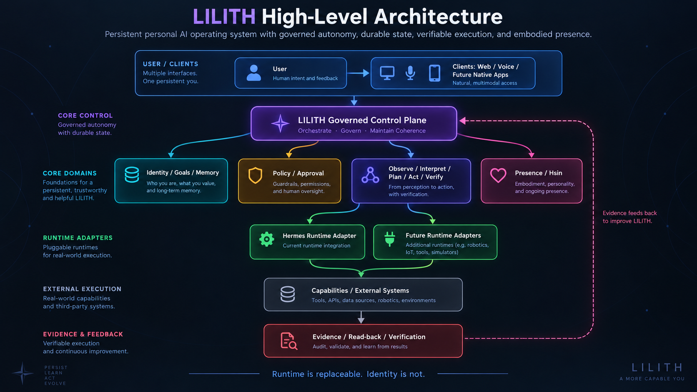
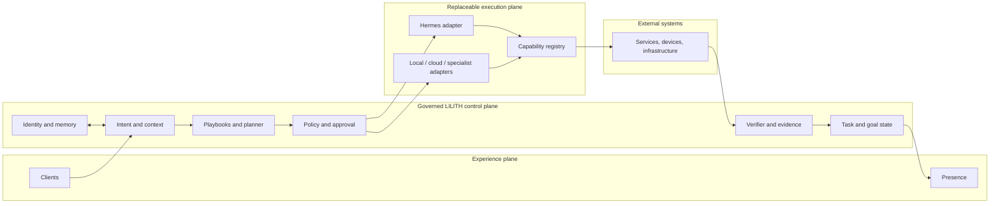

# Architecture Overview

LILITH is designed as a persistent governed system above replaceable execution substrates. The architecture separates identity and authority from model execution so
that changing Hermes, a model provider, a client, or a database does not silently create a different system or bypass policy.

## High-level architecture



## Architecture document hierarchy

| Document | Question answered |
| --- | --- |
| [Principles](principles.md) | What must remain true as the system evolves? |
| [System Context](system-context.md) | Who and what interacts with LILITH? |
| [AS-IS](as-is.md) | What is supported by current repository evidence? |
| [Target Architecture](target.md) | What architecture are we moving toward? |
| [Component Boundaries](component-boundaries.md) | What does each major part own and forbid? |
| [State and Data](state-and-data.md) | Where does durable truth live and how does it evolve? |
| [Runtime Boundary](runtime-boundary.md) | How do Hermes and future runtimes serve LILITH? |
| [Trust Boundaries](../security/trust-boundaries.md) | Where does data or authority cross into a less-trusted context? |
| [Slice 15B2b-A Canonical Runtime Foundation](slice-15b2b-a-canonical-runtime-foundation.md) | How are V2 proposals migrated, applied, packaged, and kept production-dark? |
| [Slice 15B2b-A Acceptance Record](slice-15b2b-a-acceptance-record.md) | What was accepted in source, proven in isolated DEV, and observed dark in PROD? |
| [Slice 15B2b-B1a Owner-Proof Contracts](slice-15b2b-b1a-owner-proof-contracts.md) | What synthetic WebAuthn proof is verified, and why is it not yet owner authority? |
| [Slice 15B2b-B1c Routine DEV Deployer Authority](slice15b2b-b1c-dev-deployer-authority.md) | How is routine DEV deployment cut off from root, broker, activation, Stage III and PROD authority? |
| [Slice 15B2b-B1c Acceptance Record](slice-15b2b-b1c-acceptance-record.md) | What did the real constrained DEV deployment prove, and what authority debt remains open? |
| [Slice 15B2b-B Owner Memory Control Design](slice-15b2b-b-owner-memory-control-design.md) | How can an owner-chosen memory eventually be accepted without the model, runtime, deployment, or a database write becoming authority? (design record) |
| [Slice 15B2b-B2a Accepted-Memory Contract and Verifier](slice-15b2b-b2a-accepted-memory-verifier.md) | What does the TEST-only verifier require before it returns ACCEPTED_MEMORY? (source implemented / test proven; live authority absent) |
| [Slice 15B2b-B1b-3 Authority and Key Custody Isolation Design](slice-15b2b-b1b3-custody-isolation-design.md) | How does authority-signing custody leave the application so that a compromised `lilith`, model, deployer, or DB writer cannot manufacture an accepted authority chain? (design record) |
| [Slice 15B2b-B1b-3a Authority Evidence and Key Registry Contracts](slice-15b2b-b1b3a-authority-registry-contracts.md) | What do the TEST-only registry, Owner/Actor evidence, and Privacy authorization contracts require, and how do retirement, compromise, environment, and epoch fail closed? (source implemented / test proven; live custody absent) |
| [Slice 15B2b-B1b-3b Broker-only Signing and L04 V2 Verification Adapter](slice-15b2b-b1b3b-broker-signing-l04-v2-adapter.md) | How does a TEST-only broker signer mint OwnerEvidenceV2 only after a consumed owner proof, and how does the L04 V2 adapter refuse rows, V1 HMAC evidence, and forged authority? (source implemented / test proven; live signing, live L04 V2 admission, and real custody absent) |
| [Slice 15B2b-B1b-3c Recovery Epoch and Registry Witness Semantics](slice-15b2b-b1b3c-recovery-epoch-witness.md) | How is `ledgerEpoch` bound to `RecoveryEpochV1`, and why can a restored, stale, or rolled-back ledger never revive authority, while historical evidence stays verifiable? (source implemented / test proven; live witness absent; whole-host rollback unresolved) |
| [Slice 15B2b-B1b-3d DEV_SYNTHETIC Authority Custody and OS Isolation Design](slice-15b2b-b1b3d-dev-synthetic-custody-design.md) | How would synthetic OWNER_ACTOR and recovery-witness keys be held on the real DEV host so that `lilith`, the routine deployer, and application deployment cannot read, replace, or mint authority, and a stale ledger is blocked by a surviving witness? (design record; not implemented; no key installed; no authority activated) |
| [Slice 15B2b-B1b-3d L1 DEV_SYNTHETIC Authority-Signer Source Foundation](slice-15b2b-b1b3d-l1-authority-signer-foundation.md) | Does the distinct `lilith-authority-dev` OWNER_ACTOR signer exist in source with an explicit OS boundary, reviewable install material, and fail-closed behaviour without custody material? (source foundation implemented; not installed; no credential; no authority) |
| [Slice 15B2b-B1b-3d L2 DEV_SYNTHETIC OWNER_ACTOR Custody Preparation](slice-15b2b-b1b3d-l2-custody-preparation.md) | What exact, owner-controlled ceremonies (L0, L1a–L1c, L2a, L2b) would install the signer and create the host-bound OWNER_ACTOR credential, with one mutation per step and no plaintext key on disk? (custody preparation source implemented; nothing executed; no key, blob, account, or unit created) |
| [Slice 15B2b-B1b-3d Routine DEV Deployer Authority-Boundary Hardening (DR-5)](slice-15b2b-b1b3d-deployer-authority-boundary.md) | Can a compromised routine DEV deployer prepare, modify, assume, or activate the future authority-custody domain, and how does each routine deployment prove it cannot, without counting absent paths as denials? (source control implemented; live denial not yet proven; DR-5 open) |
| [Slice 15B2b-B1b-3d DEV_SYNTHETIC Custody Preparation Live Closure](slice-15b2b-b1b3d-live-closure.md) | What did the completed live L0 through L2b.2 custody ceremony and post-K-ACT DR-5 routine deployment prove, what remained dark, and which residual risks remain open? (live closure; L2b.2 PASS; DR-5 closed; activation grant absent; DR-3 and whole-host rollback open) |
| [Slice 15B2b-B1b-3e Rotation, Revocation, Restore, and Recovery Semantics](slice-15b2b-b1b3e-rotation-revocation-recovery.md) | How does an authority key change, stop, or survive a restore without silent replacement, retroactive loss of valid history, or authority revived from restored bytes, and who requests, authorizes, executes, and verifies each transition? (design record; not implemented; no live mutation authorized; whole-host rollback unresolved) |
| [Slice 15B2b-B1b-3e Rotation, Revocation, Restore, and Recovery Source Contracts](slice-15b2b-b1b3e-source-contracts.md) | Which TEST-only contracts implement the accepted B1b-3e design: K-ROOT epoch and registry-head advance authorizations, RecoveryWitnessV2 head binding, additive registry succession, the single-current-key rule, the loaded-key binding, and the rotation state machine? (source implemented / test proven; live rehearsal not authorized; whole-host rollback unresolved) |
| [Slice 15B2b-B1b-3e Live-Rehearsal Entry Gate](slice-15b2b-b1b3e-live-rehearsal-gate.md) | Under what conditions may a DEV_SYNTHETIC B1b-3e live rehearsal even be designed: when compromise needs an epoch advance, how retained key material is classified, how the witness recovers from a torn publication, and how a successor credential is prepared side by side? (design / live gate only; RR-6, RR-7, RR-9, RR-11, RR-17–RR-21 owner-accepted; source work required before entry; no live rehearsal authorized; whole-host rollback unresolved) |
| [Slice 15B2b-B1b-3e Source Prep A: Witness Durability and Readiness](slice-15b2b-b1b3e-source-prep-a-witness-readiness.md) | How does the witness start at an owner-pinned V2 genesis, commit and recover durably without ever rolling back, re-verify the K-ROOT authorization behind every transition, and refuse readiness on an unexpected credential inventory or credential name (gate SW-3–SW-8)? (source implemented / test proven; live install absent; live rehearsal not authorized; whole-host rollback unresolved) |
| [Slice 15B2b-B1b-3e Source Prep B Design: Successor Custody and Compromise Recovery](slice-15b2b-b1b3e-source-prep-b-design.md) | How is a successor credential prepared, cut over, and the predecessor retired without dual-current or early destruction, which release and credential-name model serves rotations, and exactly how does current-key compromise recovery compose existing authority contracts (gate SW-1, SW-2, SW-9; RR-11-D1, RR-11-D2)? (design closure; RR-11-D1, RR-11-D2, RR-22–RR-30 and the compromise-epoch readiness rule owner-accepted; no owner decision pending; source not implemented; live rehearsal not authorized; whole-host rollback unresolved) |
| [Slice 15B2b-B1b-3e Source Prep B: Successor Custody and Compromise Recovery](slice-15b2b-b1b3e-source-prep-b-successor-custody.md) | How does a closed `successor <N>` keygen prepare a burned-ordinal successor beside an untouched CURRENT, how do bound HELD/RELEASED ceremony holds, the compromise-epoch rule, and the narrow C-4 gate keep every successor from readiness until an independently verified `S_CURRENT`, and how is the predecessor retired forward-only and logically destroyed (gate SW-1, SW-2, SW-9)? (source implemented / test proven; new authority-dev source release prepared, not installed; live install absent; live rehearsal not authorized; whole-host rollback unresolved) |
| [Slice 15B2b-B1b-3e PR-1 Live Install / Acceptance Preflight](slice-15b2b-b1b3e-pr1-live-install-preflight.md) | What exactly does the B1b-3d L3a–L4 prerequisite (gate PR-1) own, how is it split into source wiring, inert installation, and V2 bootstrap with owner acceptance, how is the installed `9ac7de2` release upgraded without looking like a fresh install, where do K-WIT, the authority ledger, the V2 genesis, the owner pin, and the hold store come from, and what evidence must the owner see before releasing INITIAL_CUSTODY? (live install design / preflight; no live mutation performed; RR-33–RR-40 owner-accepted, none pending; next slice PR-1S; PR-1 not authorized; B1b-3e live rehearsal not authorized) |
| [Slice 15B2b-B1b-3e PR-1S: Source / Runtime Wiring](slice-15b2b-b1b3e-pr1s-runtime-wiring.md) | Which single reviewed release can PR-1A later install: how the installed `9ac7de2` release is upgraded in place, how the live DEV_SYNTHETIC RecoveryWitnessV2, K-WIT custody, durable authority ledger, narrow C-4 wiring, RR-34 hold store, and independent root verifier with its RR-38 package digest are built, and how the deployer and custody denial proofs extend (preflight S-2 … S-15, S-20)? (SOURCE IMPLEMENTED / TEST PROVEN; LIVE INSTALL ABSENT; PR-1A NOT AUTHORIZED; B1b-3e LIVE REHEARSAL NOT AUTHORIZED; issuance unwired; whole-host rollback unresolved) |
| [Slice 15B2b-B1b-3e PR-1A Read-Only Live Preflight (Pass 1)](slice-15b2b-b1b3e-pr1a-readonly-preflight.md) | Does the live DEV_SYNTHETIC host still exactly match the accepted baseline required before the PR-1A inert upgrade of `9ac7de2`: host identity, installed release, unit state, signer account, CURRENT ciphertext identity, credstore inventory, host-key stat, PR-1 object absence, activation, DR-5, broker preservation, needrestart, and same-filesystem custody paths? (READ-ONLY LIVE PREFLIGHT; `PR1A_PREFLIGHT_PASS`; NO LIVE MUTATION; PR-1A INSTALL NOT YET AUTHORIZED; snapshot inventory NOT_COMPLETED_PR2; owner register NOT_COMPLETED_PR3) |
| [Slice 15B2b-B1b-3e PR-1A Reproducible Build / Attestation Gate](slice-15b2b-b1b3e-pr1a-build-attestation.md) | Does the exact reviewed source `aee323e` produce, in two independent clean builds, the byte-identical archive, manifest, units, fixed CLIs, and dependency inventory that PR-1A Pass 2 would install; what is the canonical non-authority build attestation; and do the installed-release verifier and the upgrade stages accept exactly that candidate? (REPRODUCIBLE BUILD / ATTESTATION; `PR1A_BUILD_ATTESTATION_PASS`; NO DEV MUTATION; PR-1A PASS 2 NOT AUTHORIZED) |
| [Slice 15B2b-B1b-3e PR-1A Final Read-Only Gate](slice-15b2b-b1b3e-pr1a-final-readonly-gate.md) | Immediately before M-A1, does the stored install candidate still match the accepted build attestation, and does the DEV host (identity, boot continuity, `9ac7de2` release, CURRENT, credstore, host key, inert units, PR1_ABSENT, activation, DR-5, broker, needrestart, filesystem) still exactly match the accepted pre-PR-1A baseline? (FINAL READ-ONLY GATE; `PR1A_FINAL_GATE_PASS`; NO LIVE MUTATION; M-A1 NOT AUTHORIZED) |
| [Slice 15B2b-B1b-3e PR-1A M-A1: Stage the Attested Release](slice-15b2b-b1b3e-pr1a-ma1-stage-release.md) | Was the exact attested candidate (`25f1ff03…`) staged beside the active `9ac7de2` release by the reviewed `upgrade-stage` only, with the selector, units, CLIs, CURRENT, services, activation, and broker unchanged? (M-A1 LIVE MUTATION; `M_A1_PASS`; STAGED RELEASE ONLY; ACTIVE RELEASE UNCHANGED; M-A2 NOT AUTHORIZED) |
| [Slice 15B2b-B1b-3e PR-1A M-A2: Select the Staged Release](slice-15b2b-b1b3e-pr1a-ma2-select-release.md) | Did the reviewed `upgrade-select` atomically move only the `current` selector from `9ac7de2` to the attested `aee323e` release, with both releases retained and units, CLIs, CURRENT, services, activation, and broker unchanged? (M-A2 LIVE MUTATION; `M_A2_PASS`; CANDIDATE SELECTED; UNITS/CLIS STILL OLD; M-A3 NOT AUTHORIZED) |
| [Slice 15B2b-B1b-3e PR-1A M-A3: Install the Reviewed Unit Bytes](slice-15b2b-b1b3e-pr1a-ma3-install-units.md) | Did the reviewed `upgrade-units` replace only the authority-dev service, socket, and tmpfiles files with the attested bytes, with no daemon-reload, no service action, CLIs still OLD, and CURRENT, custody, activation, and broker unchanged; and why does systemd already show the new definition? (M-A3 LIVE MUTATION; `M_A3_PASS`; UNIT ASSETS INSTALLED; SERVICES INERT; M-A4 NOT AUTHORIZED) |
| [Slice 15B2b-B1b-3e PR-1A M-A5: Install the Reviewed Fixed CLIs](slice-15b2b-b1b3e-pr1a-ma5-install-clis.md) | With M-A4 owner-skipped as not required (`UNITS_RELOADED`, `NeedDaemonReload=no`), did the reviewed `upgrade-cli` install exactly the six fixed CLIs with the attested bytes, with no daemon-reload, no service action, and CURRENT, custody, activation, and broker unchanged? (M-A5 LIVE MUTATION; `M_A5_PASS`; FIXED CLIS INSTALLED; SERVICES INERT; M-A6 NOT AUTHORIZED) |
| [Slice 15B2b-B1b-3e PR-1A M-A6: Retire the Predecessor Release](slice-15b2b-b1b3e-pr1a-ma6-retire-predecessor.md) | Did the reviewed `upgrade-retire-old` remove only `releases/9ac7de2…` after verifying NEW, leaving a single-release state that passes `status --expect L2b.2 aee323e…` with the selector, units, CLIs, CURRENT, services, activation, and broker unchanged, and may the merge freeze be lifted? (M-A6 LIVE MUTATION; `M_A6_PASS`; SINGLE-RELEASE STATE RESTORED; MERGE_FREEZE_ELIGIBLE_TO_LIFT, not lifted; M-A7 NOT AUTHORIZED) |
| [Slice 15B2b-B1b-3e PR-1A Transport Cleanup](slice-15b2b-b1b3e-pr1a-transport-cleanup.md) | Was only the verified M-A1 transfer directory (archive, stamp, baseline) removed from the operator home, with the host observation, release, units, CLIs, CURRENT, services, activation, and broker unchanged? (TRANSPORT CLEANUP ONLY; `PR1A_TRANSPORT_CLEANUP_PASS`; M-A7 NOT AUTHORIZED) |
| [Slice 15B2b-B1b-3e PR-1A M-A7: Inert Custody Root](slice-15b2b-b1b3e-pr1a-ma7-custody-root.md) | Did the reviewed installer `custody` stage create only the empty root-owned `0700` custody root, `prepared/`, and `retired/` on the credstore filesystem, passing `status --expect L2c`, with no credential, record, hold, witness, ledger, or service change? (M-A7 LIVE MUTATION; `M_A7_PASS`; INERT CUSTODY ROOT; post-M-A7 DR-5 pending the next routine run; M-A8 NOT AUTHORIZED) |
| [Slice 15B2b-B1b-3e PR-1A M-A8: Recovery-Witness System Account](slice-15b2b-b1b3e-pr1a-ma8-witness-account.md) | Did the reviewed `witness-account` stage create only the locked, nologin, home-less `lilith-recovery-witness` system user and group (994/984, no supplementary groups, no sudo), passing `status --expect P1A-8a`, with no units, K-WIT, witness state, or other change? (M-A8 LIVE MUTATION; `M_A8_PASS`; post-M-A7 DR-5 `P1A-7` recorded; post-M-A8 DR-5 pending; M-A9 NOT AUTHORIZED) |
| [Slice 15B2b-B1b-3e PR-1A M-A9: Recovery-Witness Unit Assets](slice-15b2b-b1b3e-pr1a-ma9-witness-units.md) | Did the reviewed `witness-units` stage create only the attested witness service, owner socket, signer socket, and tmpfiles file (root `0644`, O_EXCL), passing `status --expect P1A-8b`, with no daemon-reload, tmpfiles run, start, enablement, K-WIT, or witness state? (M-A9 LIVE MUTATION; `M_A9_PASS`; post-M-A8 DR-5 `P1A-8a` recorded; post-M-A9 DR-5 pending; M-A10 NOT AUTHORIZED) |
| [Slice 15B2b-B1b-3e PR-1A M-A10: Empty PR-1 Skeleton](slice-15b2b-b1b3e-pr1a-ma10-skeleton.md) | Did the reviewed `skeleton` stage create only the eight empty root-owned PR-1 skeleton directories, passing `status --expect P1A-9`, with no registry, register, K-WIT, witness state, ledger, hold, reload, tmpfiles run, or service change, completing the PR-1A mutation ladder? (M-A10 LIVE MUTATION; `M_A10_PASS`; P1A-8c satisfied without reload; post-M-A10 DR-5 pending; PR-1B NOT AUTHORIZED) |
| [Slice 15B2b-B1b-3e PR-1A Acceptance: DEV_SYNTHETIC Inert Installation](slice-15b2b-b1b3e-pr1a-acceptance.md) | On what evidence is the PR-1A inert installation of the attested `aee323e` release accepted, which live properties are accepted, and what does acceptance explicitly not establish? (ACCEPTED; DEV_SYNTHETIC INERT INSTALLATION ONLY; FINAL_MATURITY P1A-9; AUTHORITY_BOUNDARY PASS L1c.3; LIVE_MUTATION NONE; PR-1B, B1b-3e live rehearsal, and First Memory NOT AUTHORIZED) |
| [DR-1 DEV Memory Broker Restart Forensics](slice15b2b-dr1-broker-restart-forensics.md) | Why was the accepted Stage II broker process replaced, did anything authority-relevant change, and what must be re-proven before B1b-3d live entry? (forensic evidence record; not an acceptance record) |
| [15B2b-B1b-3d Current DEV Runtime Baseline and needrestart Control](slice15b2b-b1b3d-current-runtime-baseline.md) | Which broker incarnation does the owner accept as the B1b-3d DEV_SYNTHETIC starting baseline after DR-1, and how is needrestart kept from restarting authority-sensitive services? (owner baseline acceptance; not a Stage II acceptance; needrestart control designed, not installed) |

## Logical planes



The diagram is a target logical model, not proof of deployed components.

## Agent control loop

```text
Observe → Interpret → Plan → Policy/Approval → Act → Read back → Verify → Update state
```

The loop has explicit stop states: denied, cancelled, timed out, blocked, unknown execution state, verification failed, and partial success. “API returned success” does not automatically transition a task to completed.

## Cross-cutting authorities

Some responsibilities must apply across all execution paths:

- identity and relationship continuity;
- policy and authorization;
- canonical state and synchronization;
- provenance and evidence;
- observability and audit;
- secrets and credential isolation;
- attention and interruption policy.

No runtime, worker, plugin, or UI path may bypass them merely because it is convenient.

## Evolution rule

Keep the architecture as small as the responsibilities allow. A layer should exist only when it owns a real invariant, trust boundary, state boundary, or failure boundary. If removing a layer loses no such responsibility, merge or remove it.
