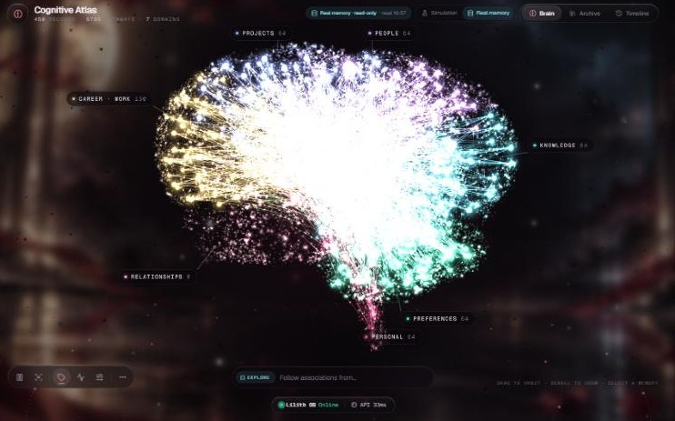
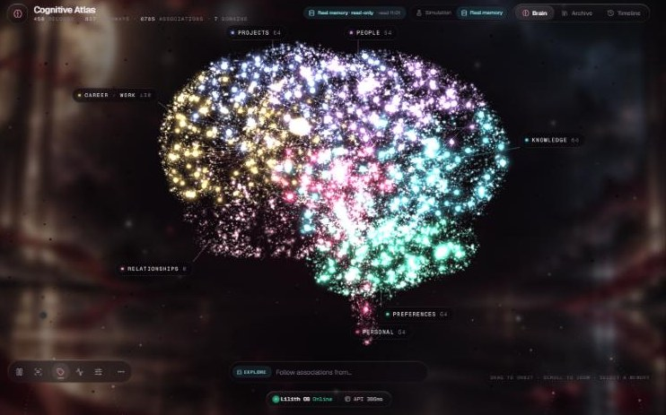
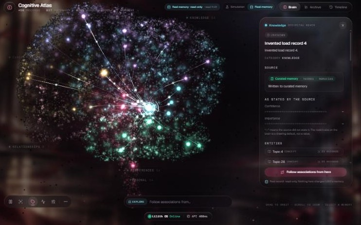
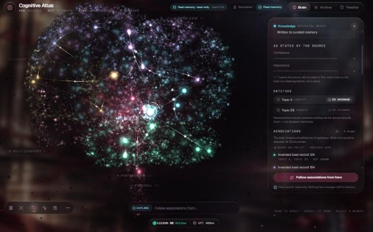

# Cognitive Atlas — Real Memory (P1-4)

The Atlas has two sources, chosen explicitly in its header and never mixed:

| | Simulation (default) | Real memory |
|---|---|---|
| Data | Synthetic graph + invented activity (`synthetic.ts`, `simulation.ts`) | Read-only projection of the memory read model (`real-source.ts`) |
| Label | "Preview · Synthetic data", "Simulated" tags | "Real memory · read-only", "snapshot" tags |
| Activity | Learning, linking, reinforcement, recall — all invented | Differences between successive snapshots — nothing else |
| Timeline | Synthetic growth history | None: the records carry no learning history |
| Store | Its own `AtlasStore` | Its own `AtlasStore`, dropped when the mode is left |

`/memory/atlas?source=real` opens Real memory directly. The choice is not
remembered; every visit opens on the simulation. The brain, its interactions
and the visual settings are shared by both.

## Data source

There is no memory event stream, and nothing new was added to the backend.
Real memory reads the same two GET endpoints the Memory Archive reads, through
the same same-origin proxy and the same normalisers:

- `GET /memory/records` → records
- `GET /memory/entities` → entities and entity-to-entity relationships

No demo or sample data is ever used in Real mode (`getMemoryData`'s demo
fallback is not on this path). No Core API schema change was needed.

## Mapping

### Categories → regions

The brain's seven regions are fixed (they are the approved visual); the memory
model has seven categories. Six map by name. The remaining pair do not line up:

| Category | Region | Notes |
|---|---|---|
| career | Career | |
| **work** | **Career** | Category stays `work`. The region is named **"Career · Work"** in Real mode, the inspector says "Category Work · drawn in the Career · Work field", and the region panel lists both categories with counts. |
| projects | Projects | Work is never placed here. |
| people | People | |
| knowledge | Knowledge | |
| preferences | Preferences | |
| personal | Personal | |
| — | **Relationships** | No category maps here. In Real mode it is empty (0) and says so. |

Why Work goes to the Career field: Career is the frontal field of roles and the
decisions that shape them, and "how you work" is closest to it; Projects is
about specific things being built. Adding an eighth region or re-purposing
Relationships would change the approved visual and invent a classification the
source does not make. The source classification is preserved on every node
(`AtlasNode.category`), so nothing downstream reads Work as Career.

Relationships stays empty rather than borrowing People records: a person is not
a relationship, and filling the region would be a visual claim the data does
not make.

### Records → nodes

Only what the source states is carried. Absent fields stay absent:

| Field | From | When absent |
|---|---|---|
| title / detail | `summary` / `content` | "Untitled record" |
| kind | `kind` (today always `unknown`) | shown as Unknown |
| confidence | `confidence` (career events only) | "—" / "not stated" |
| importance | `importance` (today always null) | "—" / "not stated" |
| createdAt | `created_at` | "not stated" (curated files have none) |
| updatedAt | `updated_at` (for files: modification time) | "not stated" |
| provenance | `provenance.{kind,label,at,source_account}` | at / account omitted |

Node size and brightness use `renderWeight(node)` — the stated importance, or a
neutral drawing default (`DEFAULT_RENDER_WEIGHT`). The default is a rendering
parameter, never shown or read back as importance.

Real nodes have no growth position (`born = 0`), no reinforcements, no recalls
and no "learned" time. The inspector shows record dates under "Record dates",
with a note that an update can be a file change and is not when Lilith learned
anything.

### Links

Two kinds of memory-to-memory pathway, kept apart in data and on screen:

- **explicit** (`explicit:a|b`) — the source lists the records as `related`.
  Inspector: "Linked by the source".
- **shared-entity** (`shared:a|b`) — derived here: both records carry the same
  entity. The link names every entity the pair shares (`via`, `viaIds`).
  Inspector: "Share an entity · derived here". A pair with an explicit link is
  not also drawn as shared.

#### What is drawn vs what exists

Every pair of records that shares an entity is an association, but drawing all
of them grows quadratically (an invented 450-record set produced 6,785
pathways and the additive glow turned the brain into a white mass). So Real
mode separates the data from the drawing:

- **Data (complete).** `associationsOf` lists every association of a record;
  `associationTotals` counts all of them, overall and per region. The node
  inspector lists them all ("33 · 4 drawn") and marks the ones not drawn.
- **Drawing (sparse, deterministic).**
  - Explicit links are always drawn, and drawn stronger.
  - For each entity, its records are joined by a minimum spanning tree over
    their hashed homes (`placeNode` with no neighbours: a function of id and
    category only), so every group stays connected through short, local
    pathways. Pairs already drawn (explicit, or by an earlier entity's tree)
    cost nothing, so trees reuse pathways instead of doubling them.
  - About one member in `EXTRA_EVERY` (4) gets one extra pathway to its nearest
    member not already joined to it, so groups read as clusters.
  - Same records → same drawn set, whatever order they arrive in; positions
    do not depend on links.
- **Focus.** Selecting a record lights all of its associations; those the
  sparse drawing leaves out are drawn in a focus overlay while it stays
  selected. Highlighting an entity from the inspector lights its records and
  the pathways that join them (its tree is connected by construction).
- **Brightness.** Ambient memory pathways dim with the square root of the
  drawn count beyond ~300 (floor 0.28), Real mode only; focused pathways keep
  full strength. Tracts and the Simulation use their own, unchanged gain.
- **Counts.** The header shows drawn pathways and, when they differ, total
  associations; the region panel shows Drawn and Associations.

Measured (invented records, production build, 1440×900): 10 records → 5 drawn
of 7, 60 fps; 100 → 160 of 311, 60 fps; 450 → 837 of 6,785, 58–60 fps;
1,000 → 1,876 of 33,986, 60 fps.

450 invented records, before and after (header: records · drawn pathways ·
associations):

| Before: all pairs (6,785 drawn) | After: sparse (837 drawn of 6,785) |
|---|---|
|  |  |
| **A record selected: all 33 associations shown (4 normally drawn)** | **An entity highlighted: its 23 records, one connected tree** |
|  |  |

Pathway brightness for real links is a drawing weight, not a measured strength,
and is not shown as a value.

**Entity-to-entity relationships** (`/memory/entities` → `relationships`, e.g.
"works at") are not memory links and are never drawn as pathways. They are
shown in the node inspector under each entity, labelled as relationships
between entities.

## Change over time

Real mode reads the records when it opens, then every 60 s while the page is
visible, and on "Check now". Each successful read is compared with the graph by
record id and a fingerprint of the stated fields:

| Difference | Event | Shown as |
|---|---|---|
| record not seen before | `record.observed` | "Newly observed" |
| stated fields differ | `record.changed` | "Changed" (stays in place unless its region changed) |
| record absent | `record.withdrawn` | "No longer in the read model" |
| source-stated link appears / disappears | `link.observed` / `link.withdrawn` | "Association observed" / "Association gone" |
| drawn shared-entity pathway changes | same events, `quiet` | not logged or counted: it follows from record changes (reported above) or from re-simplifying the drawing |

The panel says a difference is not proof that Lilith learned or forgot
anything. The first read builds the graph whole (nothing is animated as
"new" just because it was already there).

### Failures never delete

A read is accepted only when `/memory/records` answers 2xx with a records
array. No answer at all, 401/403 (refused), other HTTP errors, 503 (not
configured or unavailable) and malformed or truncated bodies are failed checks,
each named as such: nothing is removed, the header turns to "stale since HH:MM",
and the Observed changes panel names the failure. With no successful read yet,
Real mode shows "Real memory is unavailable" and draws no memories — no sample
or simulated records take their place. Records without an id are left out (and
counted) because they cannot be followed between reads. If only the entities
endpoint fails, the previous entity index is kept.

### Removal

When a successful snapshot no longer contains a record, it is removed from the
store's node map, link map, adjacency and pair indexes, from the activity log
(earlier entries about it are purged; the withdrawal entry names no content),
and from the GPU buffers (slot hidden and forgotten by id). Selection and hover
fall away because the id no longer resolves.

## Privacy

- Nothing about real records is written to `localStorage`, `sessionStorage`,
  IndexedDB or caches. The only persisted Atlas data is the visual preferences
  key (`lilith-os:atlas-prefs`: visuals + labels).
- Real data lives in the Real-mode hook's memory and is dropped when the mode
  is left or the page unmounts.
- Test fixtures are invented and shaped like the contract; no real memory,
  API response or screenshot of real data is committed.

## Exploration, not recall

The bottom console becomes "Explore associations" in Real mode: it matches a
word against record titles, tags and entities locally and follows drawn links.
It is labelled as not being Lilith's recall, and records nothing (no
`memory.recalled`, no recall counts). Suggested words are entities shared by
more than one record. Idle ambient motion stays at the level of whole regions;
individual real records are not pulsed at random.

## Boundaries

Unchanged: canonical memory authority, memory writes and learning pipelines,
Privacy/FORGET/consent, broker and witness, Core API schemas, DEV/PROD
infrastructure, production authentication. `preview-self-test.ts` enforces that
`real-source.ts` is the only Atlas file that reaches the backend;
`real-self-test.ts` covers mapping, missing metadata, links, reconciliation,
removal, failures, privacy and the simulation staying intact.

## Limitations

- Change detection is by polling; a change is seen up to 60 s late.
- The read model has no learning history, so Real mode has no timeline.
- Fingerprints compare stated fields only; a backend change that alters no
  field is invisible (correctly).
- Removed GPU slots are not reused; buffers are sized with headroom (160 nodes,
  600 pathways beyond the current graph) and rebuilt from the store whenever
  live arrivals fill them, so everything counted is drawn.
- The sparse drawing is a simplification: which pairs are drawn says nothing
  about which associations matter more. A refresh that adds a record can
  re-route a few drawn pathways in its group (quietly); positions never move.
- A focus overlay shows at most 1,024 hidden associations at once.
- On narrow screens the domain labels can show over an open panel. This is the
  existing Atlas behaviour (the Simulation does the same) and is not changed here.
- If only the entities read fails, records still update and the inspector
  marks entity relationships as coming from an earlier read.
- Real mode follows the existing Memory authorization (same proxy and session
  as the Archive). Merging this makes Real mode reachable, opt-in, wherever the
  Atlas preview is enabled; Simulation remains the default.
