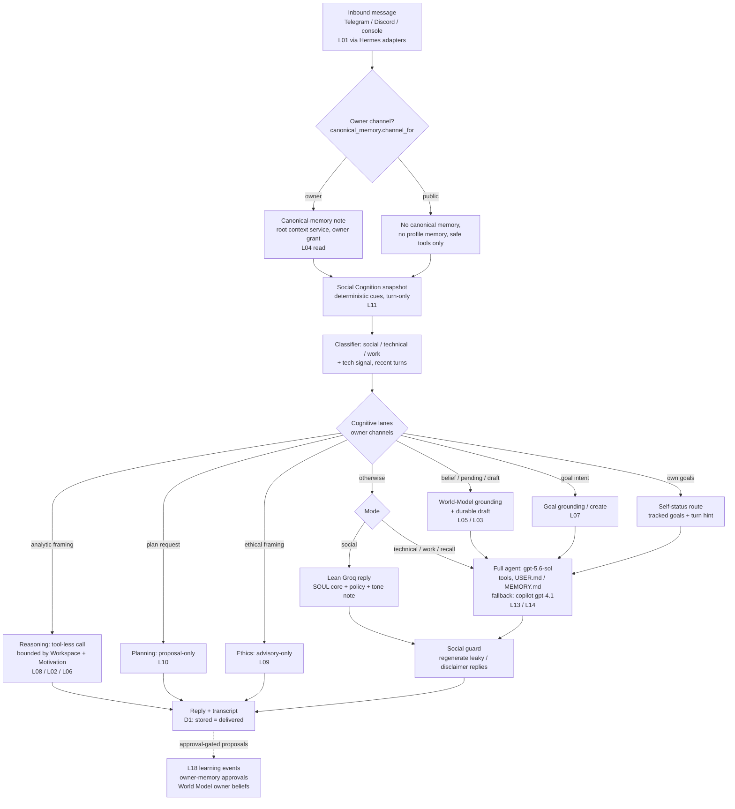

# 01. AS-IS cognitive architecture and implementation maturity

Date of evidence: 2026-11-08.
- Code references are to `main` (SOURCE-VERIFIED).
- Counts and live behaviour come from the [PROD work note](../../engineering/prod-work-note-2026-11-07.md)
  (OPERATOR-REPORTED).
- This page describes. It does not propose.

## 1. How a turn actually flows today

The 19 layers are not 19 services. On PROD, cognition happens inside one per-turn seam, `route_turn()` in
`deploy/prod/lilith_router/gateway_integration.py`, which runs in the Hermes gateway before (and around) a single model
call.

**What this shows:**
- **Lanes are mostly mutually exclusive per turn.** The first lane that claims a turn either injects grounding into the
  one model call or returns a ready answer. Only Workspace and Motivation compose, and only to bound Reasoning.
- **Learning is out-of-band and approval-gated.** In-chat proposals and the nightly review write through LILITH OS
  first (#340), then Hermes files. L18 records the events (#341).
- **There is no feedback from outcome to next-turn behaviour**, except through approved memories.

## 2. Maturity by layer

Maturity scale:
- **DESIGN**: specified only.
- **SHADOW**: computed and logged, with no effect.
- **LIVE-NARROW**: affects behaviour on a bounded path.
- **LIVE**: general.
- **ABSENT**: neither designed in code nor running.

| Layer | What exists | Maturity | Evidence |
| --- | --- | --- | --- |
| L01 Perception / Input | Hermes platform adapters; router classifier (social / technical / work, tech signal) | LIVE | SOURCE-VERIFIED `classifier.py` |
| L02 Global Workspace | Deterministic salience arbitration: 1 primary and ≤4 secondary candidates; bounds the Reasoning input only | LIVE-NARROW | Slice 10; `workspace.py` |
| L03 Working Memory | Per-turn working set for World-Model grounding (bounded top-k) | LIVE-NARROW | `_prod_world_context.py` |
| L04 Long-Term Memory | Governed canonical store; **2 admitted memories recalled on owner channels**; general creation disabled; Hermes USER.md / MEMORY.md as projections of owner-approved World Model records | LIVE-NARROW | OPERATOR-REPORTED 2026-11-06; `canonical_store.py`, `canonical_memory.py` |
| L05 World Model | Beliefs with evidence and traces (40 beliefs / 103 evidence on PROD); owner-memory beliefs (`USER_ASSERTED`, source class `OWNER_MEMORY`) | LIVE | `services/core-api`; OPERATOR-REPORTED counts |
| L06 Motivation | Ordinal drives (COHERENCE, GOAL_COMPLETION, SAFETY), with SAFETY having no live producer; adds pressure to the Workspace; no floats, no affect | LIVE-NARROW | Slice 11; [RQ-040 finding](../findings/rq-040-attention-motivation-affect.md) |
| L07 Goal / Executive | Goal store and FSM; goal grounding; create on explicit "track as a goal"; self-status route (E-T4, owner-confirmed) | LIVE | Slice 8; #351 |
| L08 Reasoning | Tool-less bounded reasoning call on analytic framings; fail-open | LIVE-NARROW | Slice 9 |
| L09 Ethical Deliberation | Advisory-only; can subtract, never add authority | LIVE-NARROW | Slice 13 |
| L10 Planning | Proposal-only plans (PLAN_PROPOSED / USER_DECISION_REQUIRED) | LIVE-NARROW | Slice 12 |
| L11 Social Cognition / Personality | Deterministic cue detector (9 evidence types), fail-closed validation, `_FORBIDDEN_KEYS`. Owner-only tone note chosen with context (#346; 14-scenario blind A/B). Personality = SOUL.md plus approved profile memory | LIVE-NARROW (owner turns) | MEASURED (work note §3a) |
| L12 Policy / Trust | Capability policy registry (5 classes, approval expiry) in the Core API; owner-only memory and tool isolation in the gateway | LIVE | Slice 5; #337 |
| L13 Capability Runtime | Hermes tool runtime; Core API command system; full-agent provider fallback | LIVE | #349 |
| L14 Connector Fabric | Typed connector registry with discovery and health gate. **Google connectors broken since 2026-08-31** (OAuth; deferred to migration) | LIVE / DEGRADED | Slice 6; work note §3d |
| L15 Verification | Read-back and verification for Core API writes (Slices 4–6). **None for conversational claims** | LIVE-NARROW | Slices 4–6 |
| L16 Meta-Cognition | No monitor. The self-status route is goal grounding, not metacognition | ABSENT | — |
| L17 Presence Director | Command Center Presence Engine and Hsin avatar foundations (console); not on messaging channels | LIVE-NARROW (console) | frontend |
| L18 Learning / Consolidation | Learning-event ledger (12 events) live; owner-approved learning live; Slice 15A consolidation worker **shadow, run once, source stale since 08-31** | event ledger LIVE; consolidation SHADOW | #341; work note §3e |
| L19 Device / Session Sync | One identity across the console, Telegram DM and Discord DM through shared canonical memory, World Model and approved profile. Each channel keeps its own conversation session; no cross-session working state | LIVE-NARROW | #355 |

## 3. Cross-cutting facts that matter for planning

1. **Measured, not assumed** (work note §3a). The native and lean models already read social context well from the
   conversation. A deterministic tone note helped on mixed and teasing turns, was neutral elsewhere, and hurt
   technical turns until the context gate (#346) fixed it. An extra social-reasoning call **was not justified by that
   evidence**.
2. **The cue detector's recall is low by construction**: 13 of 150 owner messages carried a cue in shadow. That is
   fine for a trigger and unacceptable as an interpreter.
3. **Owner learning exists and is the persistence path.** Facts and preferences the owner approves land in the World
   Model (`owner_memory`), are recorded as L18 events and are projected into USER.md. Any "persistent social belief"
   should reuse this, not invent a store.
4. **Runtime substitution already happens.** The Copilot `gpt-4.1` fallback and the Groq versus Sol split are real model
   swaps on live traffic. Identity continuity across them is unmeasured.
5. **Governance foundations are strong.** Owner-domain state, the propose / apply split, privacy FORGET (one profile),
   fail-closed validation and the constrained deployer. New cognition has to sit *inside* these, not beside them.
