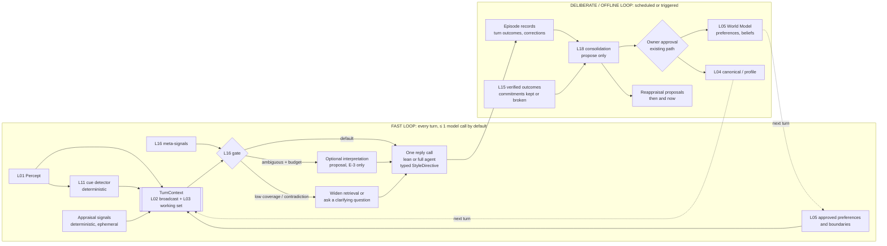

# 04. Target architecture: two loops over the 19 layers, and cross-lane coordination

This is **topic 8** (cross-lane coordination and feedback loops) and the frame for every workstream.

It does **not** replace Cognitive Architecture V1:
- the 19 layers remain the owners of state and contracts;
- what changes is the *runtime composition*, meaning how layers meet within one turn and across turns.

## 1. Two runtime loops (DeepSeek D5, adapted)



- **Fast loop.** Deterministic signals (cues, preferences, appraisal, meta-signals) are composed into one
  `TurnContext`. The default is **one** model call, exactly as today. Extra calls happen only when an L16 gate fires and
  the token budget allows.
- **Slow loop.** Episodes and verified outcomes become *proposals*. Durable change happens only through the existing
  owner-approval path. Results feed the next turn's context.
- **Feedback** closes through durable state (preferences, beliefs, memories, commitments), never through a hidden
  model-side channel (IA-37, HS-31).

## 2. TurnContext: the missing L02/L03 broadcast

Today each lane claims a turn independently and appends its own text. The first coordination change is a **single
per-turn, typed, ephemeral `TurnContext`**:
- it is assembled once in `route_turn`;
- it is read by every lane and by the reply builder;
- it is discarded at the end of the turn (V1 §7a: Working Memory is ephemeral and reconstructible).

| Field | Producer (layer) | Exists today as | Consumers |
| --- | --- | --- | --- |
| `channel`, `owner` | L19 / L12 | `canonical_memory.channel_for` | all (privacy gating) |
| `mode`, `signals` | L01 classifier | `classify()` | lanes, gates |
| `cues` | L11 | `SocialContextSnapshot` | style, appraisal, gates |
| `preferences[]` (approved, scoped) | L05 owner beliefs | owner-memory beliefs, untyped | style, interpretation |
| `focus`, `secondary[]` | L02 | Workspace snapshot (Reasoning only) | all lanes |
| `goals_active[]`, `commitments_due[]` | L07 | goal grounding (lane-local) | appraisal, style, initiative |
| `appraisal` | new, deterministic | none | style, retrieval scope, L16 |
| `meta` | L16 | none | gates |
| `budget` | L16 budgeting | lean TPM/TPD budget (local to lean) | gates |
| `style` (typed `StyleDirective`) | L11 composer | free-text tone note | reply builder (lean and agent) |

**Rule.** Lanes keep their responsibilities and their ready-answer short-circuits. They **read** `TurnContext` instead of
recomputing it, and they **contribute** only through typed fields. Prompt text is rendered once, by one renderer: today
the tone note, the canonical note and lane suffixes are each appended separately.

## 3. Typed StyleDirective (L11 → L08/L17)

This replaces the free-text tone note **without changing the approved wording**. The renderer maps the typed fields to
the owner-approved lines; any new wording needs owner approval, as before.

```text
StyleDirective {
  register: casual | formal                  # explicit request beats cue
  focus: social | task                       # technical / help-request gate (#346)
  lines: [approved-line-keys]                # playful | mixed | difficulty | support | correction | humor | formal
  preference_refs: [owner-belief-ids]        # which approved preferences shaped it (traceable)
  appraisal_refs: [signal-ids]               # which appraisal signals shaped it
  confidence: low | medium | high            # low ⇒ render nothing (silence beats a wrong note)
}
```

## 4. L16 meta-signals and controls: the rule that stops decorative metacognition

Every meta-signal must declare: **(a)** the control it may trigger, **(b)** the metric that shows the control helped, and
**(c)** its cost. A signal without all three is not built (DeepSeek D14).

| Signal (observable, cheap) | Source | Control | Metric |
| --- | --- | --- | --- |
| Retrieval coverage low (question names entities with no grounding) | World Model / canonical lookup result | widen retrieval, or ask instead of guessing | hallucinated-personal-fact rate |
| Contradiction present (belief conflict, or a correction contradicting a belief) | L05 conflict table; correction cue | surface the uncertainty; propose reappraisal | contradiction-acknowledged rate |
| Fallback or weaker model active | Hermes fallback activation | shorter answers; defer high-stakes claims; mark "I'll double-check" | error rate on fallback turns |
| Guard regenerated last reply | social guard | keep the style conservative next turn | guard-regeneration recurrence |
| Repeated correction on the same topic | L18 events | raise priority of a preference proposal | correction recurrence |
| Budget pressure (TPD > 80%) | lean budget | disable optional calls | quota exhaustion events |
| Lane disagreement (two lanes claim a turn) | route_turn | log; prefer the more specific lane | mis-route rate |

**The cognitive trace (V1 §14).** One correlation id per turn joins the existing per-lane decision-log entries. It is
the cheapest high-value L16 deliverable and a prerequisite for every experiment. It holds metadata only, never message
text.

## 5. Missing interfaces (named, not built)

| Interface | From → to | Purpose | Contract basis |
| --- | --- | --- | --- |
| `TurnContext` | route_turn → lanes / renderer | single per-turn broadcast | V1 L02/L03 `WorkspaceBroadcast`, `WorkingSet` |
| `StyleDirective` (typed) | L11 → reply builder | traceable style | V1 L11 |
| `PreferenceClaim` | L18 proposal → owner approval → L05 | scoped, evidence-backed social preference or boundary | RC-10 preference scope, RC-09 boundary precedence, E-29 |
| `EpisodeRecord` | turn end → L18 buffer | what happened, the outcome and corrections, without raw text duplication | V1 §16 episodic buffer; ML-15 |
| `OutcomeEvent` | L15 / L07 → L18, L05 | commitment kept or broken, plan step result | V1 L15; GC-21 completion proof |
| `AppraisalSignal` (ephemeral) | deterministic appraiser → TurnContext | goal or commitment relevance, congruence, contradiction | AP-03..07 (scoped down) |
| `MetaSignal` / `MetaControl` | lanes → L16 → gates | causal gating | V1 L16 |
| `CommitmentRecord` | conversation → L07 (approval-gated) | promises LILITH made | GC-07, GC-14 |
| `InterpretationProposal` | optional model call → TurnContext | experiment E-3 only | DeepSeek D6 |

## 6. Coordination invariants (unchanged governance, made explicit)

1. Signals propose; owners apply (COMP-07). No new canonical store or super-owner (COMP-02).
2. Affect, relationship and personality never authorize actions, contact or truth (COMP-23/24, AP-12, RC-08).
3. Privacy before cognition: non-owner turns get no preferences, appraisal of owner goals or memories (AH-21, ML-23).
4. Ephemeral by default: TurnContext and appraisal reset each turn. Only approved records persist (AP-27, CR-30).
5. One model call by default. Additional calls are budgeted, gated and measured.
