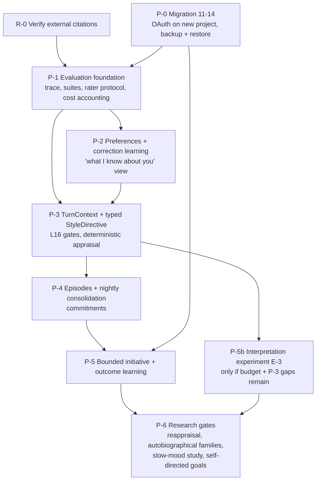

# 09. Roadmap: phases, dependencies, gates and inference costs

Evidence-gated, not date-gated.
- A phase starts with an owner go.
- A mechanism moves from offline to shadow to live only when its experiment passes ([10](10-experiments.md)).
- Each live step keeps a one-flag rollback (the `router.yaml` mode pattern already used by every lane).

## 1. Dependency graph

## 2. Phases

| Phase | Deliverables | Depends on | Promotion gate | Rollback |
| --- | --- | --- | --- | --- |
| **R-0** | Verify each DeepSeek citation (existence, venue, claim) and record it in [11](11-traceability.md) | — | — | — |
| **P-0** (now → 2026-11-18) | VM migration; durable OAuth client and one-time authorization; off-project backup with restore verification; E-10 identity suite run before and after | owner, migration plan | all identity and canonical recall items pass after the switch | old VM kept until accepted |
| **P-1** Evaluation foundation | per-turn correlated trace (metadata); frozen scenario suites (social 40, recall 30, correction 20, identity 20, technical-drift 15); blind pairwise rater tool for the owner; token and latency accounting per arm; extend `sc_eval.py` | P-0 | harness reproduces the §3a A/B result within noise | n/a (offline) |
| **P-2** Preferences and corrections | `kind`/`scope` on owner-memory records; preference proposer (explicit and repeated-correction triggers); preference retrieval into the tone path; read-only "what I know about you" view; nightly review covers Discord DM sessions | P-1 | E-2 (recall ↑, over-generalization ≤ baseline) and E-6 (recurrence ↓) | `preferences_mode: shadow` |
| **P-3** Coordination and causal gates | `TurnContext`; typed `StyleDirective` (same approved wording); L16 gates G-ASK / G-WIDEN / G-ESCALATE / G-DEGRADE; deterministic appraiser (goal relevance and congruence, correction) | P-1, P-2 | E-4 and E-5 pass; latency p95 not worse than +10% | per-gate flags |
| **P-4** Episodic layer and consolidation | episode records C-1 (privacy review, FORGET coverage); nightly consolidation proposals C-2; commitments ([07 §1](07-goals-initiative-learning.md)); reappraisal proposals C-4 | P-3 | E-7 (commitments), E-8 (episodic recall); approval-fatigue < 50% reject or ignore | stop the proposer; records stay inert |
| **P-5** Initiative and outcomes | bounded check-ins on the owner's Telegram (cap 1–2/day); outcome events from read-back → C-3 reinforcement; Slice 15A worker on a live career source (shadow) | P-4, P-0 (OAuth) | E-9 veto rate < 20%, owner-rated usefulness ≥ 4/5 | `initiative_enabled: false` |
| **P-5b** Interpretation experiment | E-3 offline, then shadow on gated turns | P-3, budget | E-3 beats the no-extra-call arm by a pre-set margin within budget | never live without passing |
| **P-6** Research gates | canonical autobiographical families (C-5); slow-mood study (AP-32 preregistration); self-directed goal policy (GC-26); learned interruption policy | P-5 evidence | separate owner decisions | — |

## 3. Explicit non-goals for this cycle

- No new lane.
- No fine-tune.
- No emotion labels.
- No persistent affect.
- No self-directed goals.
- No new canonical store.
- No change to approved tone wording without owner approval.
- No dependence on unverified external benchmarks.

## 4. Inference cost estimates

Basis (OPERATOR-REPORTED / MEASURED):
- a lean reply is about **2.7K tokens**;
- the Groq budget is **200K tokens/day** and **8K tokens/minute**;
- the full agent runs on a ChatGPT-plan model (no per-token price, subject to plan limits);
- the fallback is Copilot Free (200 requests/month);
- offline experiments are capped at ~50K Groq tokens/day.

Volumes are estimated at about 40 owner turns a day, of which about 10% are ambiguous.

| Mechanism | Extra calls | Extra tokens per affected turn | Est. per day | Share of Groq daily budget | Latency |
| --- | --- | --- | --- | --- | --- |
| Trace, TurnContext, typed style | 0 | 0 | 0 | 0% | ~0 |
| Preference retrieval (≤3 claims) | 0 | +100–300 prompt | +4–12K | 2–6% (if every lean turn carries them) | ~0 |
| Deterministic appraisal | 0 | +50–150 prompt | +2–6K | 1–3% | ~0 |
| G-WIDEN | 0 | +200–600 on gated turns | +1–3K | ≤2% | ~0 |
| G-ESCALATE | 0 (re-route) | moves a turn from Groq to the agent | −2.7K Groq per turn | frees Groq | +1–4 s on that turn |
| Interpretation call (E-3, gated) | +1 | 1.5–2.2K | 6–13K | 3–7% | +0.5–1.5 s on gated turns |
| Nightly consolidation (C-2) | 0 (extends the existing run) | — | +2–5K agent | 0% Groq | offline |
| Initiative (≤2/day) | +1–2 | 2.7K–8K | 5–16K | ≤8% (if lean) | async |
| Identity suite E-10 | offline | — | ~55K per run (20 prompts × ~2.7K) | run on low-traffic days, ≤50K/day split | offline |

**Budget rule.** The sum of added live mechanisms must stay ≤ **15%** of the Groq daily budget. Optional calls switch
off automatically above 80% daily use (G-DEGRADE).
