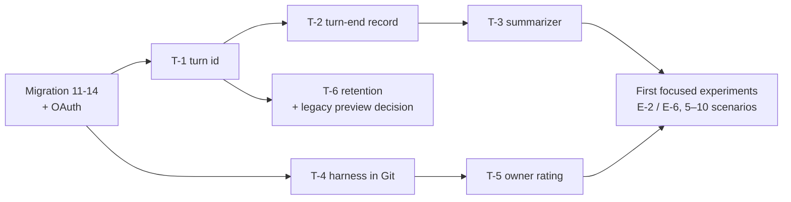

# 13. P-1 preparation: correlated per-turn trace and focused offline evaluation

Status: **PREPARED, NOT IMPLEMENTED** (2026-11-08).
- Implementation starts after the 2026-11-14 migration and OAuth recovery, with an owner go.
- This page lists the smallest changes, all reusing existing code. There is no new observability service and no test
  framework.

## 1. What exists (inventory)

**Decision log** (`OPERATOR-REPORTED`, read-only inspection 2026-11-08, metadata only):
- One JSONL file, `~/.hermes/lilith_router/decisions.log` (0600, owner `lilith`).
- 433 records over 73 days (~175 KB). **No rotation is configured.**

| Lane value | Records | Correlation today | Notes |
| --- | --- | --- | --- |
| *(none)*: routing decision | 207 | random `event_id` per record | `mode`, `confidence`, `reason`, `signals`, `live`, message length |
| `social_cognition` | 85 | own `correlation_id` (`sc.` + hash of session, message and time) | cue types, durations, fallback reason |
| `social_route` | 59 | none | route: `groq_lean`, `native_with_policy`, `native_recall`, `native_self_status`… |
| `cognitive` / `goal` / `reasoning` / `workspace` / `motivation` / `planning` / `ethics` | 75 | none | lane mode, intent, safe trace |
| `social_cognition_live` | 6 | none; uses `timestamp`, has no `platform` / `chat_id` | tone keys, focused, context flags |
| `memory_consolidation` | 1 | job id | the Slice 15A worker (not per turn) |

**Writers** (`SOURCE-VERIFIED`, `deploy/prod/lilith_router/gateway_integration.py`):
- `_log_decision`, `_log_cognitive`, `_log_goal`, `_log_reasoning`, `_log_workspace`, `_log_motivation`,
  `_log_planning`, `_log_ethics`, `_log_social_cognition`, `_note_social_route`.
- Each one opens the file and appends one record. None of them can tell which records belong to the same turn.

**Not logged anywhere structured:** the model and provider that actually answered; fallback activation (only in the
gateway journal); social-guard regeneration; D1 transcript correction; end-to-end latency; tokens per turn (the lean
path counts tokens only for its budget).

**Privacy finding.**
- 247 older records carry a `preview` field: up to 60 characters of **message text**, from both owner and public
  channels. The latest is about 5 days old.
- These came from code replaced at Cutover 2; the current router writes no text.
- **Clean-up needs an owner decision** (see T-6). It is not done now: no PROD data change before the migration.

**Offline evaluation tools** (operator-local under `p3tx/deployer/`, not in Git):

| Tool | What it does | Reuse in P-1 |
| --- | --- | --- |
| `sc_eval.py` | Replays the lean reply exactly as the router builds it, for synthetic conversations, across variants; produces blind pairs, a key and token counts; respects Groq rate limits | **Core harness**: host-side part moves into Git (T-4) |
| `sc_live_check.py`, `sc_turns.py` | Read-only log summaries since a deploy | Replaced by the trace summarizer (T-3) |
| `sc_selfcheck.py` | Runs deployed selection logic on fixed inputs (no model call) | Pattern for deterministic checks |
| `t4_synth.py` | Synthetic full-agent replay on the primary model (no tools, no session DB) | Second harness mode: agent replay (T-4) |
| `fb_e2e.py` | Throwaway-process fallback test with a fake primary | Kept as an operational test |
| `groq_quota.py` | One-request quota probe | Budget pre-check before each run (T-4) |

## 2. Tasks

Every task is a small PR, deployable through the existing pipeline (components `router` or `hermes-gateway`), with a
flag or one-line rollback.

| ID | Change | Files | Size | Depends on | Tests | Acceptance |
| --- | --- | --- | --- | --- | --- | --- |
| **T-1** Turn id | A `contextvars` `turn_id` (16 hex chars) set at the start of `route_turn`. One helper `_append_log(cfg, record)` adds `turn_id` and writes. The 10 writers call it instead of opening the file themselves. The Social Cognition `correlation_id` becomes the `turn_id` | `gateway_integration.py` (+ overlay copy) | ~40 lines, mostly deletions | — | every lane record in one simulated turn shares one `turn_id`; no text in any record; the writer never raises | after deploy, ≥95% of a day's turn records carry a `turn_id` |
| **T-2** Turn-end record | `log_turn_end(ctx, facts)` writes one `lane: "turn"` record: `turn_id`, channel label (owner / public, never ids beyond the existing `chat_id`), final route, model and provider that answered, `fallback_activated`, `guard_changed`, `d1_recorded`, `duration_ms`, tokens in and out (agent deltas, or lean usage through a contextvar from `social_lean.reply`). Called once from `run.py` right after `enforce_reply` | `gateway_integration.py`, `social_lean.py` (stash usage), `run.py` (+3 lines) | ~60 lines | T-1 | one record per turn on lean, agent, ready-answer and fallback paths; fields typed; no text | turn records = inbound owner and public turns (±2%) for one day |
| **T-3** Summarizer | Read-only daily aggregates from `decisions.log`: turns, lane mix, route mix, fallback rate, guard rate, tokens per route, p50/p95 latency, tone-key mix (owner turns). Content-free output | `tools/eval/trace_summary.py` (new, in Git) and a local transport wrapper | ~120 lines | T-1, T-2 | fixture log gives the expected aggregates; refuses to print unknown string fields | first run on PROD after a week |
| **T-4** Harness in Git | Move the host-side parts of `sc_eval.py` and `t4_synth.py` into Git as one script with two modes (`lean`, `agent`); blinding and key files; a token-budget pre-check (`groq_quota` logic); per-arm tokens and latency. **Scenario files are small focused JSON sets (5–10 each), synthetic only.** SSH transport stays operator-local | `tools/eval/replay.py`, `tools/eval/blind.py`, `tools/eval/scenarios/*.json` | ~250 lines (mostly moved) | — | blinding is deterministic per seed; the key is never written into the blind file; budget guard stops at ≤50K tokens a day | reproduces the §3a A/B direction on the 14 original scenarios |
| **T-5** Owner rating | A minimal blind rating sheet: Markdown pairs in, a JSON verdict file out. The owner rates in any editor; the scorer joins verdicts with the key and reports win rates with denominators | `tools/eval/score.py` | ~80 lines | T-4 | scorer handles ties, skips and missing items | one real rating round (E-2 or E-6 first, 5–10 scenarios) |
| **T-6** Log retention and legacy text | (a) size or age rotation inside `_append_log` (keep 30 days, one rotated file) or a logrotate entry; (b) **owner decision**: drop the legacy `preview` field from old records (rewrite without that key, keeping a backup) or delete the pre-Cutover-2 log | `gateway_integration.py` or `/etc/logrotate.d` | ~20 lines | T-1; owner decision | rotation keeps writes atomic | no `preview` field remains; the file stays bounded |

**Not in P-1:**
- dashboards or a metrics database;
- an OpenTelemetry collector;
- any model call in tracing;
- logging message text or hashes of it (F9-A D-2 rule kept);
- per-gate L16 controls (those are P-3; P-1 only *records* the signals they will need).

## 3. Order and dependencies

- T-4 and T-5 need no PROD change, but they run against the host, so they wait for the migrated host to be stable.
- T-6(b) is best done **during the migration**: carry the log without the legacy `preview` field. That is one fewer
  copy of personal text in the off-project backup.

## 4. Cost

- Zero inference for T-1, T-2, T-3 and T-6.
- Disk: about 0.5–1 KB per turn.
- T-4 and T-5 runs follow the evaluation budget: ≤50K Groq tokens a day, and agent-mode runs only on owner go.

## 5. Migration notes for P-1

- Carry `decisions.log` only after T-6(b) is decided. Never carry it into a public location.
- The local evaluation tools (`p3tx/deployer/`) reach the host by SSH transport. After the migration, update only the
  transport target. The host-side scripts in Git are host-independent.
